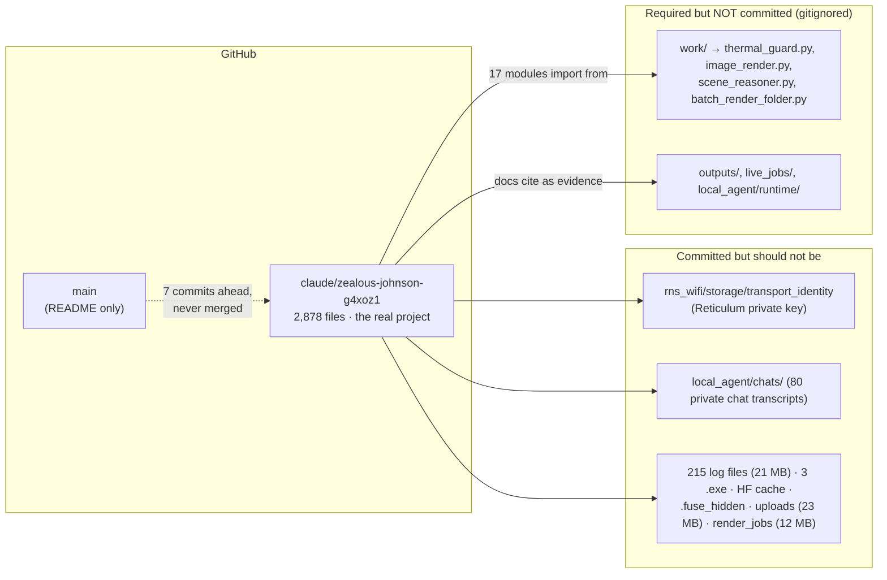

# LocalAIproject — full audit (2026-11-02)

> **Status 2026-11-06:** remediation in progress on `claude/epic-hypatia-6mrayy`.
> Hygiene (§2 findings 1, 2, 6 as far as git can do it; P2 hygiene items) and the docs
> consolidation (§4) are complete; the root-pipeline fixes (findings 7, 8, 9, 12) are
> complete; findings 3, 4, 5, 11, 13, 16–21 are applied but not yet verified item by item;
> findings 10, 14, 15 and the retrieval/compactor items are partly done. Exact state and
> next steps: `docs/HANDOFF_PROMPT_2026-11-06_finish_audit_remediation.md`.

**What was audited.** The branch `claude/zealous-johnson-g4xoz1` at commit `7fddcab` (2,878 files, 613 Python files, ~162k lines). `main` contains only a two-line README, so that branch *is* the project. Six parallel read-only code reviews covered `local_agent/server.py` + `agent.py`, `tools.py` + the permission gates, `router.py` + Ollama client + retrieval, `worker_farm/` + the Reticulum bridge, the root pipeline scripts, and the docs/process layer. Every finding below was re-verified by reading the cited lines; nothing was modified.

**Bottom line.** The data-model code is careful, the HTTP surface is better than most local apps, and 1,315 unit tests pass. But three things need attention before anything else: a real private key and personal data are committed to GitHub, the safety guarantees the docs promise (tool whitelist, GPU gate, "never delete evidence") have concrete holes, and the committed repository cannot run on a fresh clone because it imports code from a gitignored `work/` folder.

---

## 1. The shape of the problem

Think of the repo as a house where the blueprints, the furniture, and the diary all got packed into the same moving truck. The truck (git) has everything a visitor needs *plus* things that should never leave the house, and the load-bearing beams are still back at the old address.



Repo size by content: tracked logs 21.5 MB, tracked binaries/images 51 MB, chat transcripts 6 MB, knowledge caches 20 MB. Only ~10% of the checkout is source.

---

## 2. Findings ranked by severity

Severity key: **P0** = fix now, risk is live today. **P1** = real bug or guarantee violation, fix next. **P2** = hardening/maintainability.

### P0 — Secrets, privacy, and the broken safety claims

| # | Finding | Where | Why it matters |
|---|---|---|---|
| 1 | **A real Reticulum private identity is committed.** 64 bytes = X25519 + Ed25519 private keys. The bridge starts RNS with `--rns-config local_agent/rns_wifi`, so this is the live transport-node identity. Also committed: ratchet keys, the paired phone's announce, and a 300 KB `packet_hashlist.raw` that RNS rewrites every run. | `local_agent/rns_wifi/storage/transport_identity`, `local_agent/tests/rns_offline/storage/transport_identity`, `local_agent/rns_wifi/storage/ratchets/*` | Anyone with the repo can impersonate the workstation on the mesh and poison peers' path tables. **Fix:** `git rm -r --cached` both `storage/` dirs, gitignore them, delete the local identity so RNS mints a new one, and rewrite history since the branch was pushed. |
| 2 | **80 private chat transcripts (556 messages) and 23 MB of uploaded images/audio are committed.** Titles include personal device requests and explicit content prompts; `approved_tasks.jsonl` is an explicit-content eval set. `ARCHIVE_DECISION.md` says "local only, never commit" on line 1 and is tracked, and holds the backup drive's unique ID. | `local_agent/chats/`, `local_agent/uploads/`, `approved_tasks.jsonl`, `ARCHIVE_DECISION.md` | This is a public-facing GitHub repo of a private assistant's memory. **Fix:** untrack `chats/`, `uploads/`, `render_jobs/`, gitignore them, rewrite history. |
| 3 | **`write_file` writes to any absolute path, including the GPU-gate state file.** Protection is by basename only. The model can write `local_agent/runtime/gpu_gate.json` with `{"mode":"allow"}` and every later render is granted with no approval card. `outputs/equal_shares/story_config.json` is also reachable. | `local_agent/tools.py:1521-1531` | The documented "fixed whitelist" is a list of tool *names*, not of *places*. **Fix:** resolve and require `p.is_relative_to(ROOT)`, refuse `EQ` and `runtime/`, write via `atomic_io`. |
| 4 | **Four ComfyUI tools submit GPU work with no gate check.** `comfy_generate`, `comfy_workflow`, `comfy_system clear_vram`, `comfy_process start` go straight to the MCP call. `gpu_gate` is called in only 4 of the render paths. `comfy_models remove` deletes checkpoints despite the module docstring "Nothing here deletes anything". | `local_agent/tools.py:1049-1082, 1237-1302, 1263-1271` | A chat turn can queue a video next to a running batch render or unload its models. **Fix:** run the same `router.gpu_busy()` + `gpu_gate.request()` preflight; per-tool argument allowlists. |
| 5 | **Tool calls returned by the Mac worker run on the workstation with desktop privileges.** The farm result's `tool_calls` become `hop_calls` and dispatch with `context=None` → `DESKTOP_CONTEXT`, which permits everything including `run_code` and `write_file`. The Mac's Redis ACL is `~* +@all` on the workstation's own DB 0, so compromising the Mac or its `.env.mac_worker.generated` file is code execution on the workstation. | `local_agent/agent.py:3115-3124`, `local_agent/worker_farm/Add-Phase1SecondaryWorkerCredential.ps1:128-131,151` | Trust boundary is inverted. **Fix:** strip or allowlist `tool_calls` from farm results; tighten the ACL (`-@dangerous -slaveof -module -keys -select`) and move the private `distill` queue off the tunnelled instance. |
| 6 | **The committed repo cannot run.** `work/` is gitignored yet 17 `local_agent` modules and the batch runners import `thermal_guard`, `image_render`, `scene_reasoner`, `batch_render_folder` from it. `router.thermal_blocks_gpu()` does `import thermal_guard` outside a try, so any "code" turn on a fresh clone raises ImportError. 36 docs point at `work/*.py` as "the implementation"; every PASS evidence path in the Astra audit points at gitignored `live_jobs/`. | `.gitignore:106`, `local_agent/router.py:1402-1405`, `local_agent/tools.py:291,352,518`, `backrooms_watch.py:13` | The thermal guard, the single most safety-critical file, is not version-controlled. **Fix:** track `work/*.py` (ignore only `work/runtime/`), or move those modules into `local_agent/`. |

### P1 — Bugs that break the pipeline or the GPU guarantee

| # | Finding | Where |
|---|---|---|
| 7 | **The watcher never recognizes a finished clip.** The batch writes `status: "selected"`; `gvd_watcher.already_done` accepts only `done/ok/success`; the keepalive counts `status -eq 'done'`. Result: every finished clip is logged `clip_failed`, the keepalive relaunches forever, and `--force-rerun-failed` applies `--force` to the *whole* plan, re-rendering and overwriting all 100 SELECTED clips. | `gvd_watcher.py:75-79, 355`, `batch_run_backrooms_gvd.py:1261`, `gvd_watcher_keepalive.ps1:30` |
| 8 | **Progress entries are replaced wholesale on rerun/error.** `progress["clips"][cid] = {"status":"running",...}` discards the prior `video_path`, `vlm_qa`, and continuity record. The VLM QA dump is overwritten on every rerun. Violates "never delete or overwrite evidence". | `batch_run_backrooms_gvd.py:1137, 1275-1280, 476`; same shape in `master_batch_runner.py:705-731` |
| 9 | **No mutual exclusion between batch runners.** `master_batch_runner.py` has no lock; `gvd_watcher` is check-then-write with no `O_EXCL`; `gpu_watchdog.render_lock_is_held_by_someone_else()` is a stub returning False. The one correct lock (`backrooms_watch.py:62-82`, msvcrt) is used only by the legacy 24-clip pipeline. The agent never writes the render owner lock, so renders never wait for the agent either. | `gvd_watcher.py:139-148`, `gpu_watchdog.py:161-171`, `local_agent/router.py:1034-1040` |
| 10 | **GPU eviction happens only at chat-turn boundaries.** The only automatic `evict_gpu_residents()` call is inside `decide()`, and the 2-second status poll deliberately passes `ensure_gpu_evicted=False`. A render that starts 30 s after a reply leaves the 14B resident (keep_alive 5m) next to it. During a stream nothing checks `gpu_busy()`, and `chat_busy.json` actively shields the model from the watcher. | `local_agent/router.py:1807-1808, 2057`, `local_agent/agent.py:3205-3221` |
| 11 | **Gate files wipe their state on any transient read error, and the status poll triggers it every 2 s.** `_load()` returns blank on *any* exception; `snapshot()` then unconditionally saves. A Windows AV/indexer `PermissionError` erases pending approvals. Same cross-process race between the GUI server and the LXMF bridge loses one-shot approvals or grants one approval to two renders. | `local_agent/gpu_gate.py:30-53, 112-125`, `local_agent/file_edit_gate.py:12-14` |
| 12 | **`gpu_watchdog.py` would kill healthy renders if ever wired in.** 300 s stall timeout vs MiniMax jobs that run >10 min; progress signature never changes during one job; `restart_comfyui()` runs a placeholder `python main.py` with `cwd=None`; `consecutive_restarts += 1 if started else state.consecutive_restarts` doubles the counter on refusal. Unreferenced today. | `gpu_watchdog.py:106, 121-125, 296, 465` |
| 13 | **Prompt-pack render gate fails open and its operator-unlock path is dead.** `_public_args` strips `__operator_text` before the only line that reads it; the whole block is `except Exception: pass`. | `local_agent/tools.py:5067, 5115-5141` |
| 14 | **Streaming disconnect defeats the 14B→8B fallback.** `http.client.IncompleteRead` is not in the caught tuple, so an OOM mid-stream becomes a generic error instead of a reroute. | `local_agent/ollama_client.py:598`, `local_agent/agent.py:3244` |
| 15 | **Context trim has zero headroom.** Trims only when `prompt_tokens > num_ctx` (char/3.4 heuristic), never re-checks after clipping, so Ollama silently shifts context and drops the system prompt. | `local_agent/agent.py:3152, 2354`, `local_agent/router.py:1534-1538` |
| 16 | **`localhost:8760` is rejected.** Missing `f` prefix: `"localhost:{PORT}"` is a literal. | `local_agent/server.py:62` |
| 17 | **Escalation approval key uses salted `hash()`.** Changes every restart, so approvals never match and pending cards accumulate. | `local_agent/agent.py:2574` |
| 18 | **Two concurrent turns on one conversation corrupt stop/active bookkeeping**; `chat_busy` is a boolean not a refcount. | `local_agent/server.py:1687, 1849, 1886`, `local_agent/router.py:979-998` |
| 19 | **`chat_id` path traversal in the semantic judge** (no validation before building a file path from the Celery envelope). | `local_agent/worker_farm/semantic_judge.py:216-250` |
| 20 | **`/api/action` runs any registered tool with request-controlled args** and no per-route allowlist. CSRF-protected, but it is the highest-value target if the page ever gets XSS. | `local_agent/server.py:1508-1509` |
| 21 | **Paired phones get `read_file`, `list_dir`, `fetch_url` by default**; the LXMF bridge has no rate limit, unbounded inbox, 75 MB attachments with no total cap, and replies to every unpaired sender over LoRa. | `local_agent/remote_security.py:40-95`, `local_agent/lxmf_agent.py:59, 314, 470, 556` |

### P2 — Performance, hygiene, maintainability

- **Subprocess storm per hop:** up to 8 `nvidia-smi` and ~9 `tasklist` spawns per model hop, 4 `nvidia-smi` per 2-second GUI poll (`router.py:949-955, 513`). Memoize for ~1 s.
- **Retrieval:** the committed 10 MB embeddings file covers 1,049 of 2,042 index chunks; first `search_docs` on a fresh clone embeds ~1,000 chunks synchronously, all-or-nothing, with a model reload per batch (`keep_alive: "0"`), then rewrites 9 MB because index keys are `mtime:size`. Cosine is pure-Python over 2,042×768. Gitignore both JSON files, key on content hash, precompute tokens, use `array('f')`.
- **Media serving reads whole files into RAM, no `Range` support** (`server.py:609`). A 1 GB render is re-read on every seek.
- **Non-atomic state writes** despite `atomic_io.py` existing: `file_edit_gate.py:14`, `batch_run_backrooms_gvd.py:136`, `master_batch_runner.py:133`, `router.py:1090`, `submit_judge_batch.py:391`, `tools.py:706-711`. Root `atomic_io.py` is byte-identical to `local_agent/atomic_io.py` and used by one file.
- **Codemod residue:** 14 one-shot `_patch_*/fix_*/patch_*` scripts at root and ~30 under `local_agent/` are dead, and have already left double-applied conditions (`batch_run_backrooms_gvd.py:264-270, 288-300`, `generate_video.py:64-73, 554-558`) and one patch landed inside a comment (`generate_video.py:330`). Archive them.
- **Root `gvd_qa.py` is a reference blueprint nothing imports**, and its name collision forces `generate_video.py:83-93` to load `i2v_gate.py` by file path.
- **Lint:** 131 unused imports, 28 unused variables, 21 redefinitions, 8 duplicate dict keys, 12 `raise` without `from`, 1 undefined name (`live_vram_test.py:425 CLIP_GGUF`). No syntax errors in 613 files. No bare `except:`, no `shell=True`, no pickle in scope.
- **Portability:** ~13,800 occurrences of `A:\Users\rhine`; `.claude/settings.local.json` and `.claude/launch.json` (which references an unrelated `practice-score` project) are committed; `Lock-Phase1SecretFile.ps1:331` hardcodes `DURANGAMINGPC\rhine`. Two env vars (`GVD_ROOT`, `COMFY_SHARED_INPUT`) would cover the root scripts.
- **No dependency manifest, no CI, no pytest config.** Four scattered `requirements-*.txt`; tests need numpy/PIL/dspy/cryptography that nothing declares. `.github/` does not exist.
- **Monoliths:** `tools.py` 5,185 lines (840 of static schema data), `agent.answer()` ~1,260 lines, `dspy_orchestrator.py` 2,546 lines, `router.py` 2,098 lines.

---

## 3. Test baseline (run in this audit)

```
1315 passed, 91 failed, 9 skipped, 26 collection errors in 49.6 s
```

Breakdown of the 117 non-passing:

| Cause | Count | Real bug? |
|---|---|---|
| `dspy` not installed | 34 | no |
| `PIL` / `numpy` / `cryptography` / `chromadb` not installed | 33 | no |
| imports `image_render` / `thermal_guard` from gitignored `work/` | 27 | **yes, finding 6** |
| `vendor_sideband/` not tracked | 10 | no (documented) |
| Windows-only `ctypes.windll` | 1 | no |
| Genuine assertion failures | 8 | worth a look: `ComfyTimeshareTests` ×2, `HparamFallbackTests` ×2, `NativeToolTests.test_multiple_calls_one_hop`, `McpClientMockTests.test_child_env`, `VaultLayoutTests.test_protect_source_readonly` |

The suite is unittest-based (134 of 140 files), which is consistent with the "stdlib only" design. Root-level `verify_*_offline.py` scripts are `__main__` + `assert`, not a regression suite.

---

## 4. Docs and process

**The entry-point problem.** The three files agents load automatically (`README.md`, `CLAUDE.md`, `AGENTS.md`) all describe the Equal Shares soundtrack job that was paused on 2026-08-30, and disagree with each other. `AGENTS.md` is a sed'd copy of `CLAUDE.md` ("Codex driving the 124-clip pass", `.Codex/settings.local.json`) that drops the 15 lines explaining `next_changelog_id.py` and `write_handoff_status.py`. The actually-current work (`motion-transfer-chaining-handoff-26l.md`, HEAD commit) is reachable only from the top 96 lines of `TODO.md`. `AGENTS.md` says `APP_REVISION` is `...r98`; `server.py:59` says `2026-09-22i-gvd-video-pipeline-readiness`.

**CHANGELOG.** The claim mechanism works, but: 220 unlettered entries the scripts ignore, 28 orphan claims, 67 lettered entries with no claim, 12 duplicate IDs (4 after the claim system started), a parallel root-level `CHANGELOG_2026-09-18*.md` convention from the Astra agent with one ID collision (`2026-09-18e`), and 377 `.id_claims/` marker files plus the lock file tracked in git. `CHANGELOG/README.md` is a hand index that stops at 09-08.

**TODO.md.** 190 KB, 73 open / 348 closed; the real `# TODO` heading is at line 546 because sections are prepended; 235 lines of mojibake (`—`) that leak into `HANDOFF_STATUS.md`. `HANDOFF_STATUS.md` presents hard-coded Sept-4 farm state (`ORPHANS`, `PERSISTENCE` tuples in the script) as generated output.

**Recommended canonical set (8 files):** `README.md` (rewrite to one page), `CLAUDE.md` (safety rules only; make `AGENTS.md` a pointer), `HANDOFF_STATUS.md` + its script, `TODO.md` (truncate to the live head), `CHANGELOG/` + `next_changelog_id.py` (fold root `CHANGELOG_*`/`EVIDENCE_MATRIX*`/`FILES_CHANGED*` in; untrack `.id_claims/`), `local_agent/README.md` (cut to ¼), `docs/adr/`, one undated `docs/CURRENT_HANDOFF.md`. Archive the 12 dated `LOCAL_AGENT_CURRENT_HANDOFF_*.md`, `GROK_STATUS.md`, `IMPLEMENTATION_STATUS.md`, the Equal Shares start prompts, root `SYNC_STATUS.json`/`SYNC_LOG.txt` (already in `archive/stale_state/`).

---

## 5. How the GPU routing actually works (for the analogy)

Picture a single-occupancy bathroom shared by two roommates: the assistant (Ollama) and the renderer (ComfyUI).

- **The assistant checks the door only when it walks up to it** (once per model hop). It checks three things in order: is there a note on the door naming a living PID, is the light on (port 8188 answers), and is someone visibly inside (`nvidia-smi` shows >2.5 GB used or a non-Ollama compute process). If it can't see at all it assumes occupied, which is the right default.
- **If the light is on but the room is empty**, it knocks (`POST /free` so ComfyUI drops its models), looks once more, and walks in. There is a gap between "looked" and "walked in" where the renderer can also walk in.
- **Once inside, it never looks at the door again** until it leaves. A stream can run for minutes. And it hangs a `chat_busy` sign that tells the watcher not to evict it.
- **When it leaves it does not turn the light off.** `keep_alive="5m"` keeps 9-10 GB resident, and the only eviction code runs at the *next* hop. The 2-second status poll explicitly opts out of evicting.
- **The renderer never reads the assistant's note.** The assistant writes its own `gpu_owned_residents.json`, which no render script reads. So exclusion is one-directional.

The fix is cheap: evict from the status poll when `gpu_busy()` flips true and no chat is active; poll the owner file and port every N stream chunks; write the project's shared owner lock while the model is loaded; and factor `BackroomsWatch.acquire()` into a `gpu_lock.py` used by every runner.

---

## 6. Suggested order of work

1. **Purge and rotate** (same day): untrack `rns_wifi/storage`, `tests/rns_offline/storage`, `chats/`, `uploads/`, `render_jobs/`, `ARCHIVE_DECISION.md`, `*.log`, `.id_claims/`, `.hf_cache/`, `.fuse_hidden*`, `*.exe`; rewrite history; regenerate the RNS identity; rotate the Mac worker Redis password.
2. **Make the repo self-contained**: track `work/*.py` (ignore `work/runtime/`), add a root `requirements.txt` + `requirements-dev.txt`, a `pyproject.toml` with ruff config and pytest paths, and a GitHub Actions workflow that runs `pytest local_agent tests` on Linux with the optional deps mocked or marked.
3. **Close the safety holes** (findings 3, 4, 5, 11, 13): path containment in `write_file`, gate the comfy wrappers, strip farm `tool_calls`, make `snapshot()` read-only and the gate load fail-closed on OSError, re-inject `__operator_text`.
4. **Fix the pipeline vocabulary** (findings 7, 8, 9): one `already_done()` shared by batch, watcher and keepalive; merge-not-replace progress entries; shared `gpu_lock.py`.
5. **Routing** (findings 10, 14, 15, 16, 17): eviction from the status poll, mid-stream busy check, `IncompleteRead` in the retry tuple, trim with headroom, the `f`-string, sha256 key.
6. **Docs consolidation** to the 8-file canonical set; archive the 14+30 codemods; delete root `atomic_io.py`, rename root `gvd_qa.py`.
7. **Merge the work branch into `main`** (or make it the default branch). Today `main` is a README and the branch has never been merged.

---

*Verification note.* Line numbers refer to commit `7fddcab` on `claude/zealous-johnson-g4xoz1`. Each P0/P1 finding was confirmed by reading the cited lines in this session; the test run and lint counts were produced here on Python 3.13 / ruff 0.16.9. Nothing in the repository was modified by this audit.
