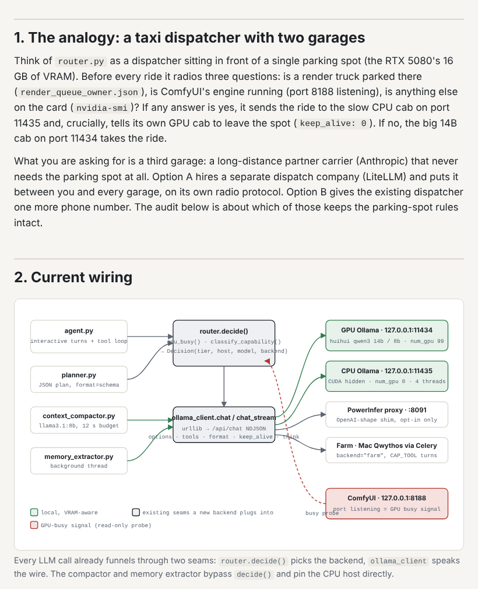

# LocalAIproject: a fully local AI assistant on one gaming PC

I built and run a ChatGPT-style desktop assistant that runs on my own Windows PC
(RTX 5080, 16 GB VRAM). It chats, calls tools, edits files, and drives ComfyUI image
and video pipelines, and it shares one GPU with those renders without
crashing them. No cloud account is needed for normal use.

This repository is my full working tree: the agent plus the ComfyUI video
pipelines, prompt packs and project history it grew up with.

**Looking for the agent itself?** The clean copy is in
[local-agent-core](https://github.com/rhinerad/local-agent-core): the full
agent in `agent/`, and the security pieces (tool allowlist, approval gates,
sandbox, quarantine, audit log) as small, tested, standalone modules in `src/`.

## How it works


A message comes in from the desktop GUI or a paired phone, goes through safety
gates, and enters a bounded agent loop. On every hop, `router.py` checks whether
the GPU is free, busy rendering, or reserved, then picks a model: a 14B model on
the GPU when it is idle, or an 8B model on the CPU when a render owns the card.
The model can only call named, allowlisted tools, never a raw shell command.

## The harness around the model


The harness is everything wrapped around the model: what it is shown, which
model gets the turn, what happens to its tool calls, and what is checked before
a reply goes out (for example, it may not claim it made a file unless a tool
actually made one).

## Routing between local and cloud models



`model_gateway/` adds an optional cloud tier behind the same router seam, so the
VRAM and thermal guards stay exactly where they are.

## Highlights

| Area | What is here |
|---|---|
| Agent loop | `local_agent/agent.py`, `router.py`, `tools.py`: hop-capped tool loop, stuck-loop guard, per-hop GPU/CPU routing |
| GPU safety | GPU permission gate, busy detection (render queue, VRAM, ComfyUI port), thermal cap |
| Sandboxing | `run_code` runs in a per-run folder with audit hooks and no network unless allowed |
| Remote access | Phone bridge over Sideband/Reticulum with paired identities; most actions are default-deny |
| Worker farm | `local_agent/worker_farm/`: a second machine takes background jobs via Redis + Celery, and its results are treated as untrusted |
| Model gateway | `model_gateway/`: optional hybrid local + Claude routing with policy tests |
| Prompt tuning | DSPy optimizers and evaluation harnesses for the video pipeline prompts |
| Tests | 180+ `test_*.py` files across the agent, router, gateway and pipelines |

Open the interactive versions of these diagrams from
[`docs/visuals/source/`](docs/visuals/source/) (download and open in a browser).

---

## Project notes (for me and my coding agents)


An offline, local AI assistant and a ComfyUI batch video pipeline, both built
for one Windows workstation with a single GPU shared between the assistant's
Ollama models and renders.

| What | Where | Status (2026-11) |
|---|---|---|
| **The local assistant** — a ChatGPT-Desktop-style app, stdlib-only, bound to `127.0.0.1:8760`, routes between a GPU model and a CPU model, tool use, memory, phone bridge over Reticulum/LXMF, optional Celery worker farm | `local_agent/` ([README](local_agent/README.md)) | active product |
| **Backrooms sitcom / GVD pipeline** — prompt pack → Flux stills → MiniMax H3 or Wan video, QA judge, motion transfer | root `*.py` (`gvd_watcher.py` → `batch_run_backrooms_gvd.py` → `generate_video.py`), `local_agent/gvd_*`, `docs/backrooms/` | active, see handoff |
| **Equal Shares** — a 124-clip film and the original reason this tree exists | `docs/GOLDEN_REFERENCE/`, `archive/equal_shares_prompts/`, `archive/superseded_docs/` | paused since 2026-08-30 |

## Read first

1. [`CLAUDE.md`](CLAUDE.md) — the binding safety, evidence, GPU and verification rules (two pages).
2. [`docs/CURRENT_HANDOFF.md`](docs/CURRENT_HANDOFF.md) — what the current job is and where it stands.
3. `python scripts/write_handoff_status.py` → [`HANDOFF_STATUS.md`](HANDOFF_STATUS.md) — generated snapshot of recent changelog entries and open TODO items.
4. [`TODO.md`](TODO.md) — the live execution queue (closed history is in `archive/TODO_closed_2026-09.md`).
5. [`CHANGELOG/`](CHANGELOG/README.md) — every change with evidence; `docs/adr/` — architecture decisions.
6. [`AUDIT_2026-11-02.md`](AUDIT_2026-11-02.md) — the full audit this layout and the November fixes came from.

## Running it

```bash
pip install -r requirements.txt            # numpy, Pillow, cryptography, psutil
pip install -r requirements-optional.txt   # only the parts you use (dspy, torch, celery, rns, ...)
python -m pytest                           # ~1,300 unit tests; conftest.py skips what this machine can't run
```

On the workstation: `local_agent\START_LOCAL_AGENT_GUI.ps1` starts the assistant;
`gvd_watcher_keepalive.ps1` drives the batch pipeline. Paths and ports come from
env vars (`GVD_ROOT`, `COMFY_SHARED_INPUT`, `COMFY_SHARED_OUTPUT`, `COMFY_URL`),
defaulting to the workstation's layout.

## What is and is not in git

Tracked: source, tests, docs, changelogs, pinned ComfyUI API graphs, small
fixtures. **Not tracked** (by `.gitignore`): model weights, renders and
`outputs/`, `work/runtime/` and `local_agent/runtime/` state, the assistant's
chat memory and uploads, logs, the Reticulum identity, `.env` files. Source in
`work/` (thermal guard, image renderer, scene reasoner) *is* tracked as of
2026-11; if your clone lacks those files, copy them from the workstation and run
`sync_up.ps1`. `scripts/untrack_private_data.ps1` removes previously committed
private files from the index without deleting them from disk.

## Folder map

| Directory | Contents |
|---|---|
| `local_agent/` | the assistant: `server.py`, `agent.py`, `router.py`, `tools.py`, gates, tests (`test_*.py`) |
| `local_agent/worker_farm/`, `edge_gateway/` | Celery/Redis farm for a Mac worker; mTLS edge gateway |
| `docs/` | specs, runbooks, `backrooms/` pipeline notes, `adr/`, `GOLDEN_REFERENCE/` |
| `CHANGELOG/` | dated entries; `astra_2026-09/` holds the Astra agent's parallel set |
| `scripts/` | changelog id claim, handoff status, sync scripts, private-data untracking |
| `tools/powerinfer/` | PowerInfer / TurboSparse experiments |
| `archive/` | superseded docs, handoffs, Equal Shares prompts, one-shot codemods. Nothing here is current. |

## Two things were called "the local agent"

The render agent was a ChatGPT/Codex/Claude session driving the Equal Shares
clip pass from a paste prompt (archived). `local_agent/` is the program. In
this tree "the agent" now means `local_agent/`.
