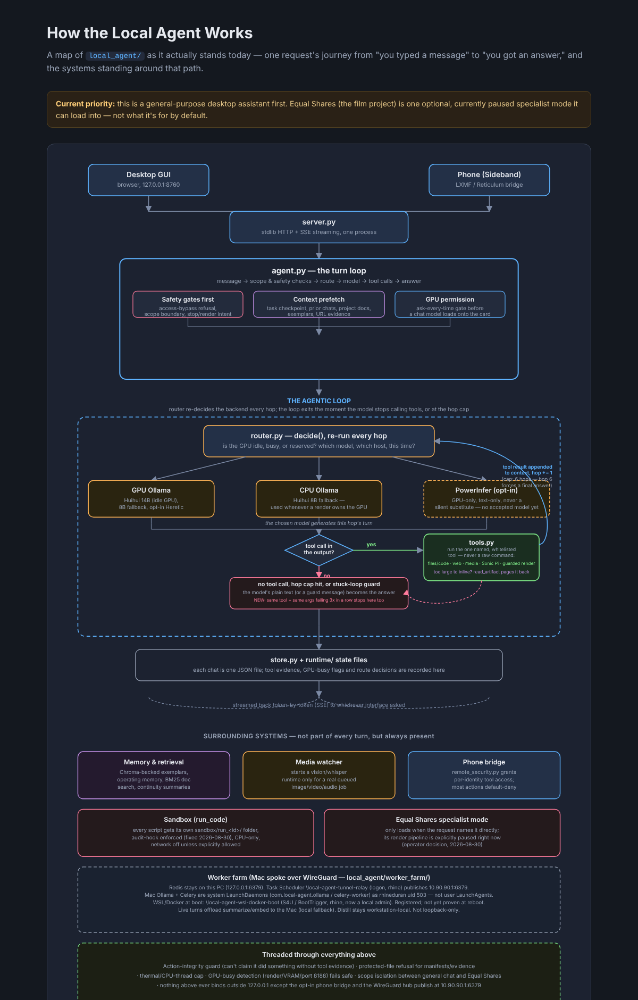
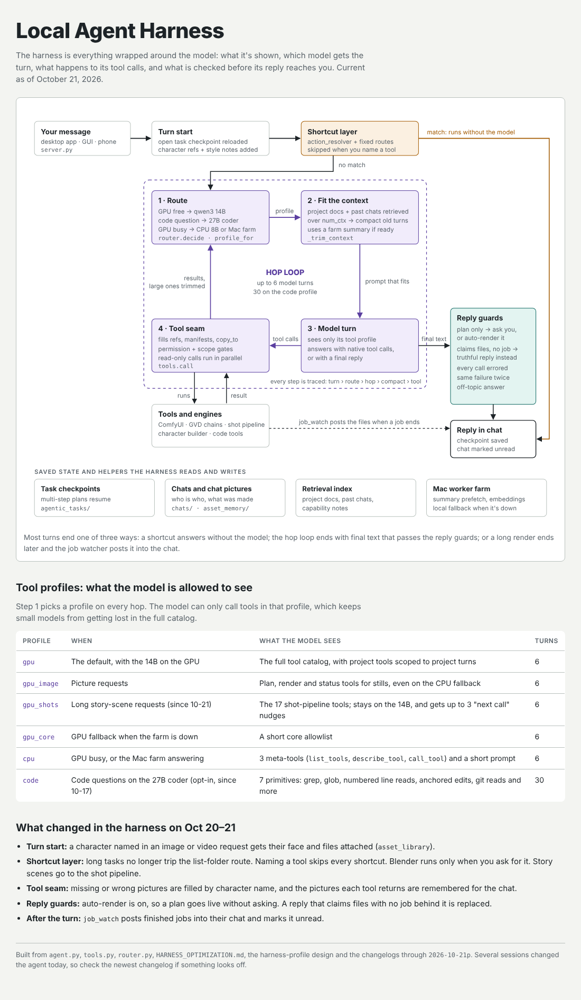
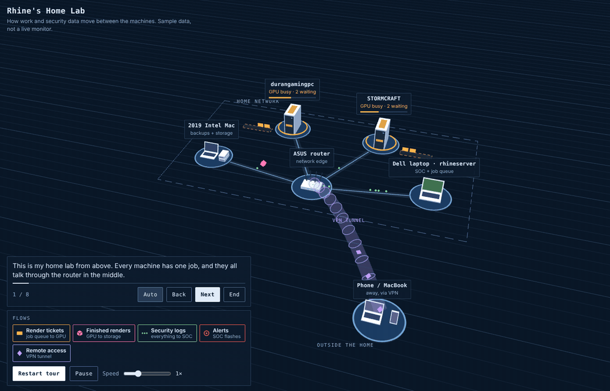

# LocalAIproject: a fully local AI assistant on one gaming PC

I built and run a ChatGPT-style desktop assistant that runs on my own Windows PC
(RTX 5080, 16 GB VRAM). It chats, calls tools, edits files, and drives ComfyUI image
and video pipelines, and it shares one GPU with those renders without
crashing them. No cloud account is needed for normal use.

This repository is the full working tree. The core security pieces (tool allowlist,
approval gates, sandbox, quarantine, audit log) are also published as small,
tested, standalone modules in
[local-agent-core](https://github.com/rhinerad/local-agent-core).

## How it works

A message comes in from the desktop GUI or a paired phone, goes through safety
gates, and enters a bounded agent loop. On every hop, `router.py` checks whether
the GPU is free, busy rendering, or reserved, then picks a model: a 14B model on
the GPU when it is idle, or an 8B model on the CPU when a render owns the card.
The model can only call named, allowlisted tools, never a raw shell command.

## The harness around the model

The harness is everything wrapped around the model: what it is shown, which
model gets the turn, what happens to its tool calls, and what is checked before
a reply goes out (for example, it may not claim it made a file unless a tool
actually made one).

## Routing between local and cloud models

`model_gateway/` adds an optional cloud tier behind the same router seam, so the
VRAM and thermal guards stay exactly where they are.

## The home lab it runs in

The PC does the GPU work. A Mac worker node takes background jobs over
WireGuard, and an old Dell laptop runs the home SOC (Wazuh) that watches all of
it.

## Highlights

| Area | What is here |
|---|---|
| Agent loop | `local_agent/agent.py`, `router.py`, `tools.py`: hop-capped tool loop, stuck-loop guard, per-hop GPU/CPU routing |
| GPU safety | GPU permission gate, busy detection (render queue, VRAM, ComfyUI port), thermal cap |
| Sandboxing | `run_code` runs in a per-run folder with audit hooks and no network unless allowed |
| Remote access | Phone bridge over Sideband/Reticulum with paired identities; most actions are default-deny |
| Worker farm | `local_agent/worker_farm/`: Mac node via Redis + Celery over WireGuard, with locked-down secrets |
| Model gateway | `model_gateway/`: optional hybrid local + Claude routing with policy tests |
| Prompt tuning | DSPy optimizers and evaluation harnesses for the video pipeline prompts |
| Tests | 180+ `test_*.py` files across the agent, router, gateway and pipelines |

Open the interactive versions of these diagrams from
[`docs/visuals/source/`](docs/visuals/source/) (download and open in a browser).

---

## Project notes (for me and my coding agents)

# Automated ComfyUI story generator — Equal Shares reference project

This folder has two linked purposes:

1. finish **Equal Shares**, a roughly 21-minute film built from 124 MiniMax H3
   clips; and
2. turn the proven workflow into a reusable automated ComfyUI story-generator
   backend.

**Equal Shares is the backend's end-to-end acceptance test.** The GUI comes
after the headless backend can plan, render, validate, retry, resume, assemble,
and audit a complete story reliably. The GUI will call that backend rather than
reimplementing its logic.

This folder is the canonical working tree. Never read project state from the
parent folder's `outputs`; it is a stale fork. Nothing under `archive/` is
current.

> **Current local-agent scope (2026-09-15):** Equal Shares pipeline work is
> paused. The separate `local_agent/` program is actively being upgraded as a
> general desktop assistant. Read
> [`docs/LOCAL_AGENT_CURRENT_HANDOFF_2026-09-15.md`](docs/LOCAL_AGENT_CURRENT_HANDOFF_2026-09-15.md)
> before changing it. The parent `outputs/` fork remains off limits.

## Read first

| File | Purpose |
|---|---|
| **`docs/GOLDEN_REFERENCE/PROVEN_FACTS.md`** | **what is actually established, each line with its measurement. Anything not in it is unproven — read it before believing anything else here.** |
| `docs/GOLDEN_REFERENCE/GOOD_AUDIO_GRAPHS.json` | the API graphs from all 16 known-good renders; the diff target for any render-path change |
| `CHANGELOG/` | every change, with evidence, written in the session it was made |
| `docs/AUTOMATED_STORY_GENERATOR_BACKEND_SPEC.md` | product goal, reusable backend architecture, state machine, and GUI boundary |
| `CLAUDE.md` | binding standing rules for agents |
| `docs/AUDIO_PASS_RUNBOOK.md` | **the working soundtrack procedure — start here for audio** |
| `docs/H3_PROMPT_RULES.md` | H3 native prompt grammar; read before editing any prompt |
| `docs/TWO_STAGE_AUDIO_FIRST_PIPELINE.md` | authoritative soundtrack-first generation logic |
| `CHATGPT_START_AUDIO_PASS.md` | **paste this to start the render agent** |
| `docs/WORKFLOW_NOTES.md` | dated evidence and decisions; newest entry first |
| **`docs/LOCAL_AGENT_CURRENT_HANDOFF_2026-09-15.md`** | **current general local-agent state, media-pipeline handoff, and explicit approval gates** |
| **`docs/ARCHITECTURE.md`** | **current-state worker farm architecture (compaction/embed offload, workstation agent ↔ Mac worker)** |
| `PROJECT_CONTINUATION_BRIEF.md` | older background and paths; audio/render order is superseded |
| **`local_agent/README.md`** | **the offline assistant — a separate program, see below** |

## Two different things are called "the local agent"

This tree uses the phrase for both. They are unrelated and confusing them wastes
time:

| | What it is | Started by |
|---|---|---|
| **the render agent** | ChatGPT/Codex or Claude Code driving the 124-clip pass | `CHATGPT_START_AUDIO_PASS.md`, `START_VOICE_AUDITIONS.md` |
| **`local_agent/`** | an offline Ollama chat app that answers questions about this project and can act on it | `local_agent\START_LOCAL_AGENT_GUI.ps1` |

Everything under `local_agent/` is the second one. It has a fixed tool whitelist
and may start only a separately guarded **general** batch render after an
explicit desktop request and strict preflight; it is forbidden from Equal Shares
output. Its new general storyboard planning path is read-only until a separately
approved image-generation action.

## `local_agent/` — the offline assistant

A ChatGPT-Desktop-style app running entirely on this machine. Standard library
only, no installs, bound to `127.0.0.1`. It routes between a GPU model when the
card is idle and a CPU model the moment a render claims it, and it evicts its own
GPU model rather than competing for VRAM.

| File | |
|---|---|
| `local_agent/README.md` | what it is, how it routes, what it deliberately cannot do |
| `local_agent/ROADMAP.md` | the end goal — a Reticulum mesh linking phone and workstation |
| `local_agent/UPGRADE/00_INDEX.md` | **numbered prompts to finish it.** Most need no internet |
| `local_agent/MORNING_CHECK.md` | the one routing check still outstanding |
| `FINISH_LOCAL_AGENT.md` | the original acceptance run |

`UPGRADE/07_batch_renderer.md` is **built** (`work/batch_render_folder.py`, 2026-08-22) and worth knowing about even if you only care about
Equal Shares: it specifies a **second, general pipeline** — point it at a folder
of numbered prompts and reference assets and it renders the batch. It reuses this
project's proven render path and thermal guard, and is forbidden from touching
`outputs/equal_shares/**`.

## Current execution order

1. Build reliable character and recurring-sound references.
2. Generate all 124 native MiniMax H3 soundtracks at 0.2 MP, using exact opening
   and closing images where supplied.
3. Validate/retry until 124/124 soundtracks are accepted.
4. Generate picture around each exact accepted soundtrack, starting at 0.9 MP.
5. On visual failure descend `0.9 → 0.8 → 0.7 → 0.6 → 0.5 → 0.4 MP`.
6. After a failed 0.4 MP take, create a `human_review_needed` item.
7. Mux the exact accepted soundtrack onto visually accepted picture.
8. Assemble, publish versioned outputs, and pass the completion audit.

No Turbo. No downloads. One ComfyUI backend/GPU owner. Never delete or
overwrite evidence.

## Current state

- The previous 0.9 MP single-pass experiment is paused and must not resume.
- Its 00A raw is preserved but rejected for gibberish narration.
- Ten characters have versioned MiniMax voice references selected from their
  first qualifying delivered appearance.
- Eight characters require first-qualifying actual-story soundtrack bootstraps
  at 0.2 MP before affected soundtrack clips can render. Invented VOX dialogue
  is disabled and prohibited.
- The derived dialogue prompts cover 78 dialogue clips; the soundtrack runner
  also includes the 46 non-dialogue clips, for 124 total.
- No soundtrack clip is accepted in the new audio-first manifest yet.
- High-resolution picture rendering is hard-blocked until 124/124 soundtracks
  are accepted.

## Implementation map

| Area | Current reference implementation |
|---|---|
| Story plan | `outputs/equal_shares/story_config.json` |
| Voice references | `work/build_voice_reference_map.py`, `work/render_audio_pass.py --bootstrap-missing-voices` |
| Audio prompts | `work/build_audio_pass_prompts.py` |
| Soundtrack render | `work/render_audio_pass.py` |
| Audio validation/review | `work/validate_audio_pass.py`, `work/review_audio_pass.py` |
| Sound continuity | `outputs/equal_shares/audio_continuity_map.json` |
| Picture render | `work/render_picture_pass.py` |
| Visual validation/review | `work/validate_visual_pass.py`, `work/review_picture_pass.py` |
| Completion gate | `work/audit_equal_shares_completion.py` |

## Folder map

| Directory | Contents |
|---|---|
| `docs/` | backend specification, pipeline, prompt rules, diagnoses, workflow notes |
| `work/` | render supervisors, prompt builders, validators, review tools, audits |
| `outputs/equal_shares/` | story config, prompts, references, audio, manifests, audit records |
| `local_agent/` | the offline Ollama assistant — its own program, own README, own upgrade plan |
| `CHANGELOG/` | every change with its evidence, newest last |
| `archive/` | superseded historical material retained as evidence |

## Important distinctions

- Rendered/mechanically valid is not accepted.
- Empty transcription is unknown, never perfect dialogue.
- Contact sheets prioritize review but never accept faces or anatomy.
- Upscaling does not repair anatomy or identity.
- Stage-2 generated audio is diagnostic; the accepted Stage-1 WAV is the final
  soundtrack authority.
- Generic backend code must not hard-code 124 clips or Equal Shares character
  names. This project is the regression fixture, not the only supported story.
