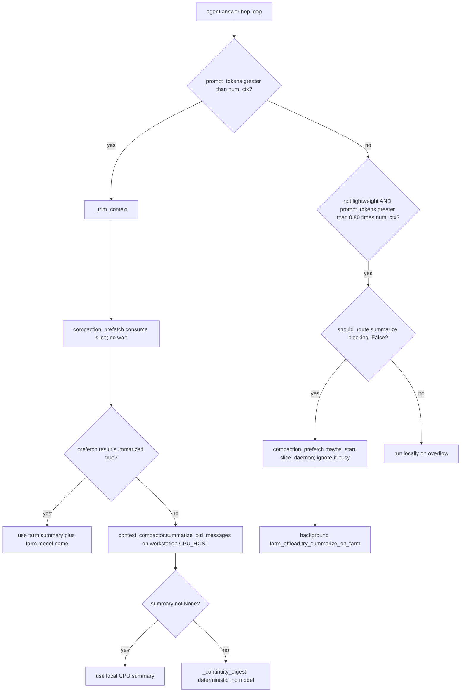
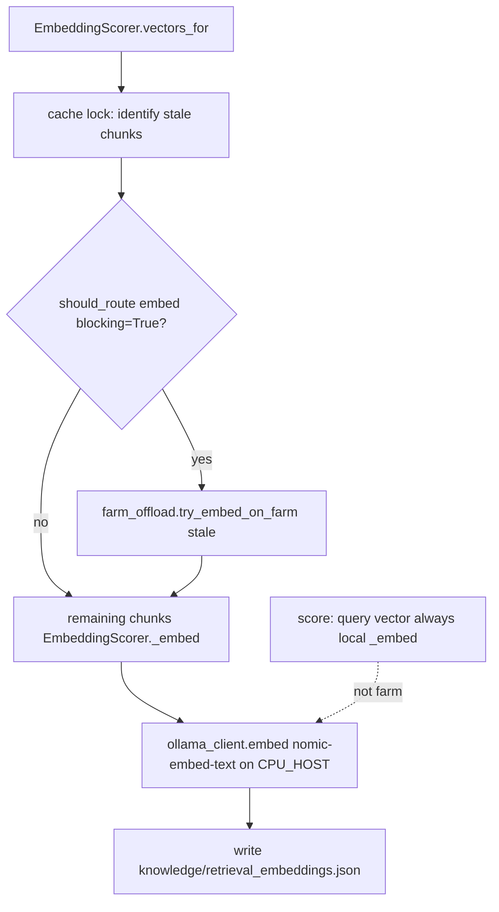
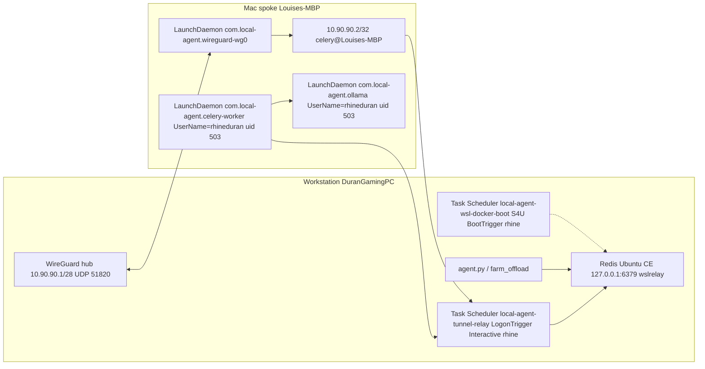

# Worker farm architecture (current state)

Written 2026-09-02 from source (`agent.py`, `farm_offload.py`, `compaction_prefetch.py`, `retrieval.py`, `worker_farm/tasks.py`, `celery_app.py`, `farm_health.py`, `farm_status_daemon.py`) plus same-day farm changelogs. Routing/health-gate re-read 2026-09-03 evening against `farm_offload.should_route` and `agent._maybe_start_farm_summary_prefetch` (`CHANGELOG/2026-09-03aw_farm_routing_caller.md`). Persistence/service topology re-read 2026-09-03 against live launchd / Task Scheduler (not a paraphrase of `GROK_STATUS.md`). Farm Redis engine re-read 2026-09-04: Ubuntu CE is live (`2026-09-03bg`/`bh` / `2026-09-04a`); Docker Desktop is rollback only.

## 1. Scope

This is the current-state picture of compaction/embed offload over the WireGuard Celery farm: workstation `agent.py` ↔ Mac worker. Live path is two queues (`summarize`, `embed`) plus the already-verified `probe` and `judge` queues on the same Mac spoke.

This doc is not:

- the 10-node plan (`docs/WORKER_FARM_ARCHITECTURE_PLAN_2026-08-29.md`, `docs/WORKER_FARM_MULTI_NODE_LAN_PLAN_2026-09-01.md`)
- the HTML GPU/CPU visual (`local_agent_architecture.html`)
- the sanitized portfolio overview (`docs/portfolio/architecture_overview.md`)

Those remain related-but-different. Do not treat them as the live farm routing picture.

## 2. End-to-end flow

The hot path **does** consult `farm_status.json` before dispatch. `farm_offload.farm_reachable()` is the inverse of the dashboard overall-degraded rule: snapshot exists, `checked_at` not older than 90s, `status == "ok"`. It does **not** call live Celery `inspect` (1–5s, farm venv). A missing/stale/non-ok snapshot means run locally immediately — no 25–30s helper timeout.

`should_route(kind, blocking=)` is the classifier:

| kind | blocking | farm-eligible when reachable? |
|---|---|---|
| summarize | True (overflow / operator turn) | **never** — warm ~18.5s, cold ~55s vs local 12s |
| summarize | False (prefetch) | yes |
| embed | True (`search_docs` stale chunks) | yes — warm ~0.58s |
| anything else | — | no |

### Compaction (in `agent.answer()` hop loop)

Each hop:

1. If `prompt_tokens > num_ctx` → `agent._trim_context(...)`.
2. Elif not `lightweight_turn` and `prompt_tokens > compaction_prefetch.PROACTIVE_THRESHOLD` (`0.80`) `* num_ctx` → `agent._maybe_start_farm_summary_prefetch(msgs)` (slice size + `should_route(summarize, blocking=False)` + `compaction_prefetch.maybe_start`; daemon thread, ignore-if-busy).

`compaction_prefetch.maybe_start` starts a background `farm_offload.try_summarize_on_farm(summarizable)` call. The hop does not wait. A down farm skips `maybe_start` entirely.

On overflow, `_trim_context`:

1. `summarizable = _summarizable_slice(msgs)` (same helper as the prefetch trigger).
2. If enough history (same ≥2 messages / ≥600 chars gate): `compaction_prefetch.consume(slice)` with **no wait**.
3. If consume returns a result with `summarized` true, use that summary and the farm model name.
4. Else `context_compactor.summarize_old_messages(summarizable)` on the workstation `router.CPU_HOST` (default `127.0.0.1:11435`, `llama3.1:8b`, 12s, `num_gpu: 0`). Overflow **never** submits to Celery.
5. If that is also `None` → `_continuity_digest` (deterministic, no model).

Emit notes distinguish `farm CPU summary (model: …)` vs `local CPU summary` vs a short continuity record.

### Farm submit (workstation helper)

`farm_offload._run_helper` does **not** import Celery in the agent env. It requires the farm venv Python (`worker_farm/.venv/Scripts/python.exe` on Windows) plus `worker_farm/_farm_submit_wait.py`; otherwise it returns `None`. It spawns that venv, JSON on stdin: `task` / `queue` / `envelope` / `timeout_s`. Caller wait is 135s prefetch-summarize (above the worker's 120s Ollama ceiling) / 30s embed; subprocess timeout is that plus 15s. Overflow never waits. Any error/timeout → `None` (never raises).

`_farm_submit_wait.main` loads `worker_farm/.env` (`FARM_BROKER_URL`), `app.send_task(..., queue=...)`, then `AsyncResult.get(timeout=timeout_s, propagate=False)`.

### Mac worker

`worker.py` launches Celery `-A local_agent.worker_farm.celery_app:app`. `tasks.summarize_conversation` → `_summarize_messages` → `context_compactor.summarize_old_messages(..., model=FARM_SUMMARIZE_MODEL or llama3.1:8b, timeout=120)`. Missing/unreachable model → `{"summarized": false}` (not an error). Changelog `2026-09-02r` records `FARM_SUMMARIZE_MODEL=krith/mistral-nemo-instruct-2407-abliterated:IQ4_XS` on the Mac. That worker's Ollama is local on `127.0.0.1:11434` (not the workstation CPU port `11435`).

### Embed path (not in `agent.py`)

`search` / `search_docs` default to `HybridScorer` (`retrieval._DEFAULT_SCORER`, 2026-09-02ab). **That default is inert until workstation CPU Ollama `:11435` is brought up on purpose.** The query vector in `score()` is always local `_embed` on `router.CPU_HOST` (never farm). If `:11435` is down, `HybridScorer.score()` catches the embed error and ranks lexical-only — same top-5 as `LexicalScorer`. Bringing `:11435` up (or leaving an eval instance running) is what turns dense ranking on; do not do that as a side effect. Live-dense 2026-09-03bb was mixed; two regressions must be understood before dense is a deliberate production decision: `phase1_stay_on_ollama` (gold rank 1→9; Hybrid's top-5 becomes older PowerInfer scaffold docs) and `judge_not_registered` (gold 2→12; loses the exact NotRegistered root-cause section). Chunk vectors still go through `EmbeddingScorer.vectors_for`: cache lock → identify stale chunks → `should_route(embed, blocking=True)` then `farm_offload.try_embed_on_farm(stale)` outside the lock → remaining chunks `EmbeddingScorer._embed` → `ollama_client.embed(..., nomic-embed-text, router.CPU_HOST)` → write cache. A down farm skips Celery and goes straight to `_embed`. Mac `embed_chunks` uses the worker's own Ollama (`127.0.0.1:11434` on the Mac), not this workstation `:11435`. Farm dashboard / `farm_status.json` do not probe `:11435`.

### Local fallback

Farm helper returns `None`; summarize result `summarized: false`; `ImportError` / any exception; prefetch miss / fingerprint mismatch; venv or helper missing. Then workstation Ollama; then continuity digest.

Parallel embed path:

## 3. Modules

**`local_agent/agent.py`.** Imports `compaction_prefetch` at top; `farm_offload` inside `_maybe_start_farm_summary_prefetch` (hop loop, 80% ctx). Helpers `_protected_tail_start`, `_summarizable_slice`, `_maybe_start_farm_summary_prefetch`, `_trim_context`. Overflow consumes a ready prefetch or goes local — it does not import `farm_offload`. Emit notes distinguish farm CPU summary (model: …) vs local CPU summary vs continuity. Does not import `farm_health` or `farm_status_daemon`; reachability is the `farm_status.json` snapshot. Hop-loop tool exceptions (2026-09-03a): the main-thread mixed-hop slot and the sequential else-branch now wrap `run_one()` in `try/except Exception` the same way the pooled path already did, converting a raise into `ERROR: {Type}: {exc}` on the next hop instead of escaping `answer()` as a 500.

**`local_agent/farm_offload.py`.** Classifier + submit wrappers. `farm_reachable()` / `should_route()` read `farm_status.json` with the same stale/ok rule as `dashboard.collect.is_farm_degraded` (imported `STALE_AFTER_S` / `is_stale`, not a second copy). `try_summarize_on_farm` (queue `summarize`, task `local_agent.worker_farm.tasks.summarize_conversation`) and `try_embed_on_farm` (queue `embed`, `embed_chunks`) subprocess into `worker_farm/.venv` + `_farm_submit_wait.py`. `None` means run locally. Does not call live `farm_health.check_farm_health`.

**`local_agent/compaction_prefetch.py`.** One-slot state machine IDLE / PREFETCHING / READY; sha1 fingerprint of the summarizable slice (`role` + first 120 chars); `maybe_start` / `consume`; imports `farm_offload` only in the background thread.

**`local_agent/worker_farm/tasks.py`.** Allow-listed Celery tasks: `distill_export`, `judge_transcript`, `summarize_conversation`, `embed_chunks`, `connectivity_probe`. Summarize uses `context_compactor`; embed uses `ollama_client.embed` + `router.CPU_HOST` and does not write `knowledge/retrieval_embeddings.json`. `OSError` retries 3x except `connectivity_probe`. Workstation caller for summarize/embed is `farm_offload`.

**`local_agent/worker_farm/farm_health.py`.** Standalone CLI / `check_farm_health()`: load `.env`, TCP `FARM_BROKER_URL`, Celery `inspect.ping()`. Never submits jobs. Live CLI is a diagnostic — the hot path does not import this module. Live 2026-09-02 worker name: `celery@Louises-MBP`.

**`local_agent/worker_farm/farm_status_daemon.py`.** Interval writer (default 30s) of `worker_farm/farm_status.json` via `check_farm_health`. That snapshot **is** the hot-path reachability signal (`farm_offload.farm_reachable`).

Related files (not the hot path): `celery_app.py`, `worker.py`, `_farm_submit_wait.py`, `relay/tunnel_relay.py`, `wireguard/*.ps1`, `compose.yaml`.

## 4. Queues

Declared in `celery_app.py` (must be in both `task_queues` and `task_routes`): `distill`, `probe`, `judge`, `summarize`, `embed`. Visibility timeout 3600s. Mac consumer (changelog `2026-09-02r`): `--queues probe,judge,summarize,embed`. Workstation `START_PHASE1_CPU_WORKER.ps1` only starts `distill`.

- **probe** — `connectivity_probe`. Prove tunnel + ACL. Returns hostname / platform / pid / received_at. Producer: manual `send_task`. No `agent.py` producer.
- **judge** — `judge_transcript`. Deterministic rubric on `chat_id` + messages. Producer: `submit_judge_batch.py` over `local_agent/chats/*.json`. Consumer: mac_worker. Advisory only.
- **summarize** — `summarize_conversation`. Compaction offload. Producer: `compaction_prefetch` via `farm_offload` (prefetch only). Overflow uses local CPU. Caller 135s; worker Ollama 120s. Live 2026-09-03 consume-win: 117s on `celery@Louises-MBP` (concurrency 1). A 25s caller ceiling timed out the first prefetch of the session.
- **embed** — `embed_chunks`. `{id, text}` → `{id: vector}`, `nomic-embed-text:latest`, 768-dim. Producer: `EmbeddingScorer.vectors_for`. Caller 30s. Warm ~0.58s. Query embedding stays local.

`distill` is declared and consumed only by the workstation Phase-1 worker, not the Mac. It is not part of the live Mac farm path.

## 5. Persistence and networking

Star WireGuard: workstation hub `10.90.90.1/28` UDP 51820, interface `hub`, Windows service `WireGuardTunnel$hub`. Hub LAN IP `192.168.50.208`. Next free peer `10.90.90.3`.

Mac spoke `10.90.90.2/32`, names `Louises-MacBook-Pro.local` / Celery `celery@Louises-MBP`. SSH user `rhineduran` (uid **503**). Deployed copy `~/worker_farm/` on the Mac (not this tree).

Redis Docker `local-agent-phase1-redis` bound `127.0.0.1:6379` only; compose `restart: unless-stopped`. Relay `tunnel_relay.py --bind-ip 10.90.90.1` publishes `10.90.90.1:6379` → `127.0.0.1:6379`, max 64 conns.

`FARM_BROKER_URL` shape only (no live password):

- workstation: `redis://:<password>@127.0.0.1:6379/0`
- Mac: `redis://mac_worker:<password>@10.90.90.1:6379/0`

`celery_app` allows Redis hosts `127.0.0.1` and `10.90.90.1:6379` only, path `/0` or `/1`, password required.

### Who starts what (live 2026-09-03, not the 2026-09-02 nohup picture)

**Mac Ollama and Celery are system LaunchDaemons, not user LaunchAgents.** Labels `com.local-agent.ollama` and `com.local-agent.celery-worker` live in `/Library/LaunchDaemons/` with `UserName=rhineduran` `GroupName=staff` (uid 503, not root). `KeepAlive` + `RunAtLoad`. gui/503 copies of those labels are **disabled**; `~/Library/LaunchAgents/com.local-agent.*` is gone. Evidence: `CHANGELOG/2026-09-03z_mac_headless_launchdaemons.md`. Reconfirmed this session over SSH: both `type = LaunchDaemon`, `domain = system`, `username = rhineduran`; ollama pid **336** uid 503 `lstart` 15:53:49 (tracks cold boot `kern.boottime` 15:53:17); celery pid **5933** uid 503 (LaunchDaemon `runs=2` after a 16:33 SIGTERM/kickstart — still the system job, not a gui agent); curl `127.0.0.1:11434/api/tags` HTTP 200.

**Mac WireGuard** is a third system LaunchDaemon `com.local-agent.wireguard-wg0` (root `wg-quick`, not the Ollama/Celery user). Reboot persistence of the tunnel itself: `CHANGELOG/2026-09-03r_mac_persistence_reboot.md`. Reconfirmed this session: `state = running`, `runs = 1`.

**Workstation tunnel-relay is a registered Task Scheduler job, not a manually-started listener.** Task `\local-agent-tunnel-relay`: RunAs `rhine`, LogonType **Interactive**, trigger **MSFT_TaskLogonTrigger** for `DURANGAMINGPC\rhine` (not BootTrigger / not S4U). Action: `runtime\run_tunnel_relay_task.cmd` → farm venv `tunnel_relay.py --bind-ip 10.90.90.1`. Evidence: `CHANGELOG/2026-09-03s_tunnel_relay_logon_interactive_task.md` (registered) and `CHANGELOG/2026-09-03x_tunnel_relay_free_bind_run_success.md` (task owns Listen). Reconfirmed this session: Status **Running**, Last Run 15:30:21, Listen `10.90.90.1:6379` OwningProcess **43152** (task-spawned python; SessionId 1). LastTaskResult `-2147020576` while still running is expected. This job fires at interactive logon; it is not a pre-login / Session-0 listener.

**Workstation farm Redis is Ubuntu-24.04 Docker CE, started at boot.** Task `\local-agent-wsl-docker-boot`: RunAs `rhine`, LogonType **S4U**, trigger **MSFT_TaskBootTrigger** / At system start up, delay **PT30S**. Action: `C:\Program Files\WSL\wsl.exe -d Ubuntu-24.04 --exec /bin/bash .../keep-alive.sh boot`. `DURANGAMINGPC\rhine` is a **local Administrator** (`net localgroup Administrators` = `Administrator`, `rhine`, `tiffa`) — that grant is what unblocked rhine-as-self S4U (`CHANGELOG/2026-09-03y_rhine_added_to_local_administrators.md`). Proven at boot: `2026-09-03au` (Docker CE keep-alive), Phase C cutover `2026-09-03bg`, first delayed-login Redis proof `2026-09-03bh` (same boot reconfirm `2026-09-04a`), **Phase D second-boot persistence proof `2026-09-04c`**. Two distinct `LastBootUpTime` values now show Ubuntu CE Redis StartedAt after boot and before explorer, Windows `127.0.0.1:6379` as `wslrelay`, and ACL `mac_worker` present. Phase D persistence claim is closed. Live container `local-agent-phase1-redis`; Windows `127.0.0.1:6379` is `wslrelay`. User-env `FARM_REDIS_ENGINE=wsl` is the effective default on DuranGamingPC. `START_PHASE1_BROKER.ps1` / `doctor.py` still treat unset as `desktop` — that is **Desktop rollback only, not the live default.** Do not wait for Docker Desktop **Engine running** as the primary procedure. Docker Desktop AutoStart is off. `\local-agent-wsl-docker-logon-watchdog` (Interactive / LogonTrigger) remains as the delayed-login rescue.

Related workstation tasks (not the three persistence owners above): `\local-agent-farm-status-daemon` (Interactive / LogonTrigger, currently Running) and `\local-agent-handoff-status` (Interactive / weekly).

Do **not** treat the 2026-09-02 persistence bullets as current:

- `2026-09-02r` “Ollama is nohup / launchd not configured / restart relay manually” is superseded by `2026-09-03z` + `2026-09-03s`/`x`.
- `2026-09-02d` “If the Mac reboots, worker needs manual restart (launchd not set up)” is superseded by the system LaunchDaemons.
- `2026-09-02a` “relay should be added to a launcher/autostart” landed as `\local-agent-tunnel-relay` (logon, not boot).
- Redis secondary ACL after container restart is a separate path (`2026-09-03l` / `2026-09-03o`); in-memory ACL without the restore hook is no longer the live picture.
- `GROK_STATUS.md` dated LaunchAgent lines from earlier 2026-09-03 are stale vs `2026-09-03z`. The HTML GPU/CPU visual `local_agent_architecture.html` is a different document; its farm box was brought in line in the same pass as this section.

## 6. Known limitations / open items

Pulled only from unclosed `TODO.md` items (plus one changelog-only gap). Do not invent extras.

- Hybrid `search_docs` is the code default but **effectively lexical** until CPU Ollama `:11435` is started deliberately (`CHANGELOG/2026-09-03bf_cpu_ollama_11435_stopped_fail_closed.md`). Do not treat a live `:11435` as “Hybrid is on in production.” Before ever turning dense on for real, address the two 2026-09-03bb regressions: `phase1_stay_on_ollama` (rank 1→9) and `judge_not_registered` (loses the NotRegistered root-cause chunk).
- Phase 2 item 5 (Swarm offload) parent checkbox is `[x]`; routing uses `farm_status.json` via `farm_offload.should_route` (prefetch-only summarize; blocking embed when reachable).
- `[ ]` LLM-based judge pass follow-up (semantic failures); needs a decision whether secondaries use local Ollama or call back to the workstation.
- `[ ]` Explicit operator decision before staging any real historical export (`distill`).
- Secondary-laptop item still `[ ]` even though the Mac joined; the body still says “Still needed: relay autostart so it survives reboots; repeat Add-WireGuardPeer + credential steps for each additional machine (.3, .4, ...).” Relay autostart on this workstation **did** land as `\local-agent-tunnel-relay` (logon / Interactive, `2026-09-03s` / `x`) — that TODO sentence is stale for the current spoke, still true as a reminder for additional machines and for pre-login relay (Boot/S4U relay was not registered).
- `[ ]` 10-node asynchronous Worker Farm and all sub-bullets — planning only.
- `[ ]` Private-overlay edge gateway before phone/Termux Celery batches.
- Mac Ollama/Celery as user LaunchAgents / nohup is closed (`2026-09-03z`: system LaunchDaemons, `UserName=rhineduran` uid 503). Workstation Redis-at-boot on Ubuntu CE is closed after two boots (`2026-09-03bg`/`bh`/`2026-09-04a` first boot; `2026-09-04c` Phase D second boot). Remaining persistence gap that is **not** a new TODO: tunnel-relay still needs an interactive rhine logon (Boot/S4U `\local-agent-tunnel-relay` was not registered). Mac WireGuard/Celery reboot persistence is still unconfirmed.
- `[ ]` **Dynamic capability-based model routing — planned, not started (2026-09-04).** Extend `router.py` (not a new file) to hand off between three new models by task type: `richardyoung/qwythos-9b-abliterated` (lightweight tool-calling, Mac worker), `huihui_ai/deepseek-r1-abliterated:14b-qwen-distill` (deep logic, host RTX 5080), and a Josiefied-Qwen2.5-Coder-14B pull (coding, host RTX 5080 — exact Ollama tag unconfirmed, may need `ollama create` from the HF GGUF). Host can only hold one resident 14B at a time; swap must send `keep_alive:0` to the currently-loaded model and wait for confirmed unload before loading the next — same mechanism `context_compactor.py` already uses, do not build a second one. VRAM sizing done ahead of implementation: `MODEL_VRAM_BUDGET.md` — Q4_K_M @ `num_ctx=8192` (11.74GB, 4.3GB headroom) is the recommended config for the reasoning model; Q8_0 fails the 16GB check outright; a 32B alternative fails at every quant/context combo tested; an 8B alternative fits with large headroom but is a reasoning-depth tradeoff. Companion idea, same status: a model-aware **harness profile** switch (CPU profile leaning on `action_resolver.py`-style deterministic pre-resolution + a reduced meta-tool set, vs the full GPU profile) keyed off this same routing signal — `docs/FARM_EFFICIENCY_EVALUATION_2026-09-04.md`. Nothing in this bullet is live; no model pulled as of this writing.