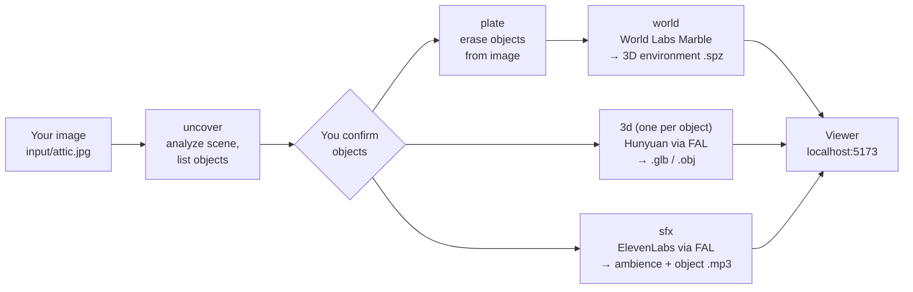

# Using image-blaster on your computer

[image-blaster](https://github.com/neilsonnn/image-blaster) turns **one picture** into:

| You get | File type | Made by |
|---|---|---|
| An explorable 3D environment (the room/landscape itself) | `.spz` Gaussian splat (+ `.glb` collider, panorama) | World Labs **Marble** |
| 3D models of the movable things in the picture (chairs, lamps, crates...) | `.glb`, `.obj` | **Hunyuan 3D** via FAL |
| Background ambience + per-object sound effects | `.mp3` | **ElevenLabs SFX** via FAL |

It is not an app you click around in. It is a set of **instructions and scripts for Claude Code** —
you talk to Claude, and Claude runs the pipeline.

---

## The mental model (analogy)

Think of it like a **film production crew**, with Claude as the director:

- **You** hand the director a single location photo.
- The **location scout** (`uncover`) studies the photo and writes a shot list: "the scene is a
  dusty attic; movable props are: rocking chair, lantern, trunk."
- The **set cleaner** (`plate`) digitally removes the props from the photo so you have an empty set.
- The **set builder** (`world`, World Labs) turns that empty-set photo into a 3D stage you can walk around.
- The **prop shop** (`3d`, Hunyuan) builds each prop as its own 3D model, one craftsperson per prop,
  working at the same time.
- The **foley artist** (`sfx`, ElevenLabs) records room tone plus a sound for each prop
  (a creaky chair, a clinking lantern).
- The **screening room** (the viewer at `localhost:5173`) lets you see everything put together.

Why remove the props before building the world? Because otherwise the chair would be "painted into"
the 3D room and you couldn't move it. Empty stage + separate props = a scene you can rearrange.



Rough timing: the whole thing usually takes about **5 minutes** once it starts; the 3D models and
sounds are generated in parallel.

---

## What you need (one-time)

| Thing | Why | Get it |
|---|---|---|
| **Git** | download the project (and on Windows, Claude Code needs Git Bash) | https://git-scm.com/downloads |
| **Node.js 18+** (LTS) | runs the generation scripts | https://nodejs.org |
| **Bun** | runs the 3D viewer | Windows: `powershell -c "irm bun.sh/install.ps1 \| iex"` · Mac/Linux: `curl -fsSL https://bun.sh/install \| bash` |
| **Claude Code** | the agent that drives everything | Windows: `irm https://claude.ai/install.ps1 \| iex` · Mac/Linux: `curl -fsSL https://claude.ai/install.sh \| bash` |
| **World Labs API key** | builds the 3D environment | https://platform.worldlabs.ai/ |
| **FAL API key** | 3D models, sounds, image edits | https://fal.ai/ (Dashboard → Keys) |

> **Costs money.** World Labs and FAL bill per generation. Load a small amount of credit first and
> keep "confirm each step with me" on until you know what a blast costs you.

After installing tools, **close and reopen your terminal** so it picks them up.

---

## Setup (inside this LocalAIproject repo)

1. Get this repo onto your computer (skip if you already have it):

   ```bash
   git clone https://github.com/rhinerad/LocalAIproject
   ```

2. Run the setup script from the `LocalAIproject` folder. It checks your tools, clones
   image-blaster into `tools/image-blaster/`, creates `.env`, and installs the viewer.

   **Windows (PowerShell):**

   ```powershell
   cd LocalAIproject
   powershell -ExecutionPolicy Bypass -File scripts\setup-image-blaster.ps1
   ```

   **Mac / Linux / Git Bash:**

   ```bash
   cd LocalAIproject
   bash scripts/setup-image-blaster.sh
   ```

   Re-run the same command any time to **update** image-blaster to the latest version.

3. Open `tools/image-blaster/.env` in Notepad / VS Code and paste your keys:

   ```
   WORLD_LABS_API_KEY=wl_xxxxxxxxxxxxxxxx
   FAL_KEY=xxxxxxxx-xxxx-xxxx-xxxx:xxxxxxxxxxxxxxxx
   ```

   (Or skip this and just paste the keys to Claude when it asks — it will write the file for you.)
   This file is git-ignored, so the keys never get committed.

---

## Your first blast

1. Start Claude Code **inside the image-blaster folder** (this is what loads its skills, hooks and rules):

   ```bash
   cd tools/image-blaster
   claude
   ```

   On start, Claude automatically checks your keys and tells you if one is missing.

2. Copy an image into `tools/image-blaster/input/`. Good images: a clear wide shot of a room,
   street, or landscape with a few distinct objects. A photo, render, concept art, or AI image all work.

3. Tell Claude:

   ```
   blast it and confirm each step with me
   ```

4. Claude will:
   1. create a project under `worlds/<name>/` and start the viewer,
   2. describe the scene and propose a list of objects — **reply with which ones to keep**,
   3. ask whether to make a clean plate (erase those objects) — usually say **yes**,
   4. generate the world, the 3D objects, and the sounds,
   5. give you a link like `http://localhost:5173/<name>`.

5. Open the link in your browser to fly around the world and see the objects and sounds.

Once you trust it, you can skip the check-ins: `blast it in one-shot`.

---

## Useful things to say to Claude

| Say | What happens |
|---|---|
| `blast it and confirm each step with me` | full pipeline with check-ins |
| `blast it in one-shot` | full pipeline, no pauses |
| `just make the world, no objects` | environment only |
| `make a 3d model of the lamp` | one object |
| `make the lamp low poly` / `use 200000 faces` | Hunyuan options (`--generate-type LowPoly`, `--face-count`) |
| `make a geometry-only version of the chair` | white untextured mesh (`--generate-type Geometry`) |
| `redo the chair, the legs are wrong` | regenerates using the right skill |
| `make a rain ambience for this world` | extra SFX |
| `remove the people from the image too` | custom clean plate |
| `open the folder for <name>` | shows where the files are |
| `what worlds do I have?` | lists projects |

Advanced: you can call the individual skills directly with slash commands, e.g.
`/image-blast-3d attic lantern` or `/image-blast-sfx attic ambience`.

---

## Where your files end up

```
tools/image-blaster/
├── input/                      ← drop images here
├── .env                        ← your API keys (private)
└── worlds/
    └── <world-name>/
        ├── project.json
        ├── image.json          ← scene analysis
        ├── source/             ← your original image + clean plate
        └── output/
            ├── world/          ← N-world-full_res.spz, N-world.glb, N-world-pano.png ...
            ├── sfx/            ← ambience .mp3
            └── <object>/       ← N-<object>.glb / .obj, reference image, sfx/
```

The number prefix (`0-`, `1-`, `2-`...) is the version: `0` is the original, higher numbers are
newer generations. Nothing is overwritten, so you can always go back.

### Using the files elsewhere

- **Blender**: File → Import → glTF (`.glb`) for objects. For the `.spz` splat, use a Gaussian
  splat add-on (or import the `.glb` world mesh as a stand-in).
- **Unity / Unreal / Godot**: drop the `.glb`/`.obj` files in as assets; use a Gaussian splat plugin for `.spz`.
- **Three.js / web**: the built-in viewer is a React Three Fiber app (`tools/image-blaster/app/`)
  using Spark for splats — a good starting point to copy from.

---

## Viewing results later

The viewer only runs while its server is running. To start it again:

```bash
cd tools/image-blaster
bun run dev
```

Then go to `http://localhost:5173/<world-name>`. Press `Ctrl+C` in that terminal to stop it.

---

## Letting the LocalAIproject agent use it

If you start Claude Code from the **LocalAIproject root** instead, it reads `CLAUDE.md` and the
`image-blaster` bridge skill (`.claude/skills/image-blaster/SKILL.md`). That agent knows:

- how to install/update image-blaster if it's missing,
- that every script must run from inside `tools/image-blaster/`,
- to ask before spending API credits,
- how to run a headless blast (`claude -p "..."` inside the folder) or a single step script.

For the best experience (check-ins, background subagents, auto key checks), still run `claude`
from inside `tools/image-blaster/` when you're doing a blast yourself.

---

## Troubleshooting

| Problem | Fix |
|---|---|
| `'claude' / 'bun' / 'node' is not recognized` | install it, then open a **new** terminal window |
| PowerShell: "running scripts is disabled" | use the `powershell -ExecutionPolicy Bypass -File ...` command shown above |
| Claude says a key is missing | paste the key into the chat, or fix `tools/image-blaster/.env` (no quotes or spaces around `=`) |
| `401` / `403` / "unauthorized" from FAL or World Labs | key is wrong or account has no credit — check the dashboard |
| Viewer page won't load | run `bun run dev` in `tools/image-blaster` and use port `5173`; if the port is busy, close the other dev server |
| Hooks error on Windows (`bash: ...\r`) | the files got Windows line endings; delete `tools/image-blaster` and re-run the setup script (it clones with LF line endings) |
| A generation failed halfway | ask Claude to `resume` / `fix the <thing>` — request metadata is saved so it can pick up where it left off |
| Files missing after a crash | ask Claude to "repair local assets" (it runs `ensure-local-assets.mjs`) |
| `bun run test` shows 2 failures about env vars | expected until both keys are set in `.env` |
