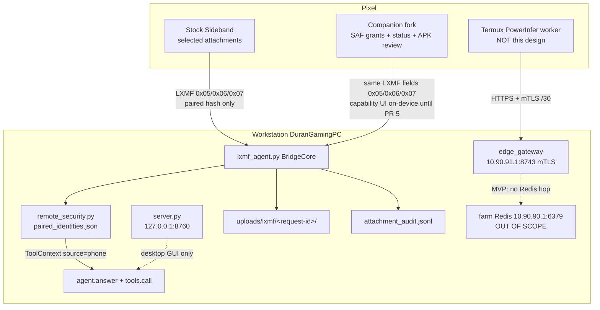
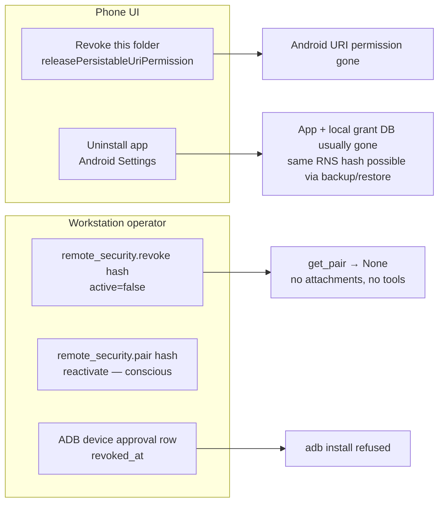
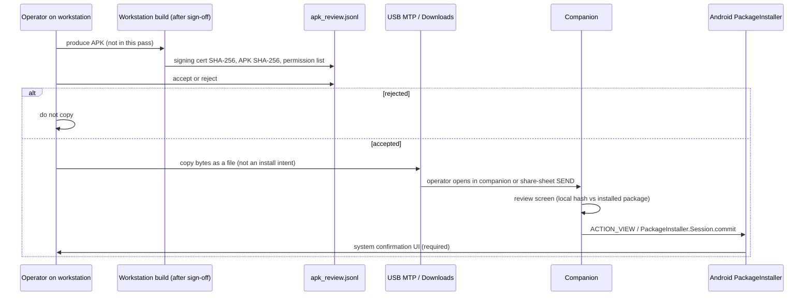

# Design: trusted Android companion (SAF grants, capability status, APK delivery)

| Field | Value |
|---|---|
| **Document** | Operator-sign-off routing contract for the paired-phone companion upgrade |
| **Date** | 2026-09-05 |
| **Status** | **PR 0 accepted 2026-09-05.** A1–A14 accepted with recommended defaults (K1–K10). **PR 1–3 shipped.** **A13 authorized.** **PR 3b isolated spike APK compiled** (`2026-09-05di`, package `local.equalshares.safspike`, not sideloaded). Persistable SAF across restarts still **unverified**. Companion NDK pin remains r25b. Open question 6 open until a device run. |
| **TODO** | `TODO.md` “Trusted Android companion: approved phone files and app delivery” |
| **Prior art (tone/rigor)** | `docs/design_notes/POWERINFER2_EDGE_GATEWAY_2026-09-05.md` (G1–G10) |
| **Live phone path today** | Stock Sideband → `local_agent/lxmf_agent.py` `BridgeCore` → `remote_security.ToolContext` → `agent.answer()` |
| **Checked-in fork (unbuilt)** | `local_agent/vendor_sideband/` package `local.equalshares.sidebandagent` (`SIDEBAND_TIER_B_BUILD.md`) |
| **Out of scope here** | Equal Shares soundtrack/picture, ComfyUI GPU, farm overlay `10.90.90.0/28`, edge-gateway `10.90.91.0/30`, unattended install, `MANAGE_EXTERNAL_STORAGE` / all-files, binding `0.0.0.0`, changing `GATED_REMOTE_TOOLS` grants |

This is the **routing contract**, not an implementation spec that authorizes a toolchain download. Stock Sideband already delivers the selected-attachment path. This item is the deliberate companion upgrade: persistable per-folder grants, revoke + capability status, workstation-built APK review, and an optional USB/ADB install mode that cannot exist on LXMF / Wi-Fi / LoRa.

**No Android code, APK, Sideband-fork edit, or production-agent change ships from this document.** The first PR is operator sign-off of A1–A14.

---

## Overview

The workstation already treats a phone as a **paired LXMF identity**, not as a logged-in HTTP client. `server.py` stays on `127.0.0.1:8760`. Attachments from a paired sender are copied immutably under `local_agent/uploads/lxmf/<request-id[:32]>/`, hashed, size-capped, and audited; unpaired senders are refused before any bytes hit disk. Gated tools stay default-deny per identity.

The upgrade adds three phone-side capabilities **on top of that same trust model**, not beside it:

1. **Storage Access Framework (SAF) tree grants** — the operator picks each folder; the companion may list/read only inside persistable URI permissions; it **must not ship** `MANAGE_EXTERNAL_STORAGE` / all-files.
2. **Capability status + revoke** — a screen that shows pairing, grants, APK identity, and permissions; folder revoke, pairing deactivate, and APK uninstall are three different actions with different owners.
3. **APK delivery with human install confirmation** — workstation-built APK, signing identity + SHA-256 + manifest-permission review, then Android’s own package installer. Optional USB/ADB trusted-device install is a **workstation** script with per-device fingerprint + exact hash approval. Unattended installation over LXMF, Wi-Fi, or LoRa must be **architecturally impossible**.

A lost Pixel with a paired Sideband identity is still a workstation **chat, read-tool, and attachment** client until the operator revokes it (ungated `read_file` / `list_dir` / `list_memory` are live today). It must never become a silent app installer, a farm peer, a ComfyUI **job submitter**, or a whole-disk reader.

---

## Background & Motivation

### What already works (do not reimplement)

| Piece | Where | Behavior |
|---|---|---|
| Pairing store | `local_agent/remote_security.py` `PAIRINGS` = `runtime/lxmf/paired_identities.json`; aliased as `PAIRINGS_FILE` in `lxmf_agent.py:53` | 32-hex LXMF destination hash; `active` flag; `allowed_tools` list |
| Pair / revoke / grant CLI | `remote_security.pair`, `.revoke`, `.set_tool_grant`, `_cli()` | Workstation-only. `pair()` reactivates; `revoke()` sets `active: false` without erasing the row |
| Unpaired refusal | `BridgeCore.handle` (`lxmf_agent.py:514–524`) + `record_unpaired_attempt` | One-line “Not authorised…”; identity + request_id only; **no attachment save** |
| Tool context | `ToolContext` (`remote_security.py:75–91`); `context_for()` | `source="phone"`; `permits()` denies `GATED_REMOTE_TOOLS` unless granted |
| Dispatch chokepoint | `tools.call()` (`tools.py:3385–3427`) | Unknown tool refused; gated tool denied + audited; model cannot forge identity |
| Attachment ingest | `_receive_attachments` / `_save_attachment` (`lxmf_agent.py:365–429`) | Stock Sideband fields `0x05` file / `0x06` image / `0x07` audio; paired sender only |
| Immutable copy | `_save_attachment` | `uploads/lxmf/<request-id[:32]>/`; `open(..., "xb")`; never replace; collision → `stem_<sha256[:10]>suffix` |
| Size cap | `MAX_ATTACHMENT_BYTES = 75 * 1024 * 1024` (`lxmf_agent.py:60`) | Empty or oversized → drop that item (`return None`) |
| Hash + audit | attachment JSONL `sha256` full hex; `ATTACHMENT_AUDIT_FILE` | Event `received_attachment`; no bytes in the chat record or audit row |
| Progress to phone | `_phone_event` | Status labels only; never tool args, results, local paths, or media bytes |
| HTTP | `server.py` `HOST, PORT = "127.0.0.1", 8760` | Not the phone transport |
| Tier B overlay (source only) | `vendor_sideband/`, `SIDEBAND_TIER_B_BUILD.md`, `test_sideband_tier_b.py` | Camera capture into the **existing** medium-image field. **Not compiled.** |

`test_lxmf_bridge.py` already locks: unpaired refusal (no `uploads/`), gated `write_file` denied, image attachment is path-only + `received_attachment` audit, video file routed by extension, progress never exposes secrets.

### Pain this item exists to solve

Stock Sideband (and the plyer Android filechooser in the vendored fork) uses **`Intent.ACTION_GET_CONTENT`** — a one-shot document picker. That is the accepted selected-attachment path. It cannot:

- remember a folder the operator approved yesterday
- list that folder later without another picker
- show a grant/revoke capability screen
- review a workstation-built APK before Android’s installer
- distinguish “operator chose this tree” from “app requested all files”

The checked-in fork **declared** `MANAGE_EXTERNAL_STORAGE` in `vendor_sideband/sbapp/buildozer.spec`. That was the opposite of this TODO. **PR 3** (source-only, no compile) deleted that token from the spec and landed the static forbid in `test_sideband_tier_b.py` in the same change.

Upgrade 06b (PWA) is push-only by construction: a browser cannot take persistable tree URI permissions. `UPGRADE/11_android_native_app.md` Phase 3 already named SAF as the capability the PWA cannot give. This design is that contract, written to the same sign-off standard as the edge gateway, **before** any SDK/NDK/Buildozer download.

### Adjacent product that must stay a different hop

The PowerInfer-2 edge gateway (`local_agent/edge_gateway/`, G1–G10 accepted) is a Termux **inference worker** over `10.90.91.0/30`. This companion is an LXMF **chat/file client**. Mixing them — putting farm Redis, the edge token, or `10.90.90.0/28` on the Sideband identity — is how a lost phone becomes a farm incident. See hop diagram below.

---

## Goals & Non-Goals

### Goals

- Operator-chosen **per-folder** SAF grants with persistable URI permissions.
- Every phone file that reaches the workstation still hits the existing pairing / immutable copy / SHA-256 / 75 MiB / attachment-audit path. No second ingest.
- Phone UI: grant list, revoke grant, capability status.
- Workstation UI/CLI: pairing deactivate, grant-metadata mirror, APK review record, optional ADB device ledger.
- Workstation-built APK delivery with signing identity, exact SHA-256, and requested-permissions review; **Android package installer shows the final confirmation**.
- Optional USB/ADB trusted-device install: per-device approval + fingerprint + exact APK hash.
- Acceptance tests (after sign-off and a later build): selected file/image/audio/video; granted-folder listing and revocation **on a grantable tree** (`Documents/…` or a user-created folder — **not** `Download/`, volume root, or `Android/data`); APK review/install confirmation; phone-loss / re-pair refusal.

### Non-goals

- Equal Shares audio/picture pipeline, manifests, or `outputs/equal_shares/**`.
- ComfyUI, port 8188, GPU jobs, `start_batch_render` from the phone (remains in `GATED_REMOTE_TOOLS`, default-deny).
- Farm overlay `10.90.90.0/28`, Redis/Celery, edge-gateway listen, Termux `--gateway`.
- Unattended / silent package install over LXMF, Wi-Fi, LoRa, or any in-app API.
- `MANAGE_EXTERNAL_STORAGE`, `WRITE_EXTERNAL_STORAGE` (legacy), or MediaStore “all files” access — not as a default, and not as a signed exception in v1.
- Agent-driven crawl of the phone outside granted trees (no `tools.list_dir` against the handset).
- Binding `server.py` to `0.0.0.0` or serving the GUI over LAN “so the phone can install.”
- Replacing Reticulum/LXMF with HTTP as the remote transport.
- Auto-pairing from `unpaired_attempts.jsonl`.
- Device-owner / device-admin / `INSTALL_PACKAGES` privileged APIs.
- Compiling, signing, or sideloading an APK in this pass.

---

## Key Decisions

These are the decisions this document is asking the operator to accept. They are restated as A1–A14 in the sign-off list. Recommended defaults are in **bold**.

| ID | Decision | Recommended default |
|---|---|---|
| **K1** | Client shape | **Sideband fork** (`local.equalshares.sidebandagent`), not a PWA and not a greenfield Kotlin RNS stack. PWA cannot hold persistable SAF tree grants (`UPGRADE/06b_phone_app.md`). A second RNS implementation is out of scope (`UPGRADE/11_android_native_app.md` Phase 0). Stock Sideband remains the selected-attachment client and must keep working. Persistable tree listing is **gated on a no-product-APK pyjnius spike** (PR 3b, after A13, before PR 4). If that spike fails, v1 degrades to one-shot `GET_CONTENT` and **drops persistable listing** — it does not switch stacks. |
| **K2** | Trust model | **Reuse** `remote_security.py` + `lxmf_agent.py` ingest. Do not add a phone login, a second identity file, or an HTTP session. Folder grants are Android URI permissions. A later grant-metadata **mirror is never authorization**. |
| **K3** | Storage permission | **SAF only.** Companion `buildozer.spec` / merged manifest **must not ship** `MANAGE_EXTERNAL_STORAGE`. The current vendored spec line that includes it is a defect relative to this TODO and is **deleted in PR 3** (same PR as the static forbid). Not “the first Android UI PR.” |
| **K4** | Who lists the phone | **Phone UI lists granted trees.** The workstation model does not gain a `phone_list_dir` tool in v1. If a later signed-off PR adds one, it may only query persistable grants the operator still holds, with the same 200-entry cap as `tools.list_dir`, and still cannot read a file the operator did not send. |
| **K5** | How files cross | **Push, then existing ingest.** Companion reads bytes **only** from a granted tree (or a one-shot picker / camera / mic), sends them as stock LXMF fields `0x05/0x06/0x07`. Workstation `_save_attachment` is unchanged. No phone-path string is a capability. |
| **K6** | APK delivery in v1 | **USB MTP / Downloads (or the §5 ADB ledger), never LXMF outbound.** Live `LXMFBridge._send` (`lxmf_agent.py:630–648`) builds text + `equal_shares_agent` metadata only — there is **no** outbound `FIELD_FILE_ATTACHMENTS` (0x05) path. Do not bolt 0x05 onto `_send`. A later outbound-file helper would be its own signed-off PR and still must not auto-install. Phone-side, an `.apk` that arrives via USB, share-sheet `ACTION_SEND`, or a future outbound helper is a **file**: review screen, then system `PackageInstaller` UI. No LXMF field, MIME handler, or receiver starts `pm install`. |
| **K7** | Size cap vs APK | **Keep `MAX_ATTACHMENT_BYTES` = 75 MiB** on the existing **inbound** phone→workstation path. Do not raise it to fit an APK. v1 does not send APKs workstation→phone over LXMF at all, so the mesh cap is not the v1 delivery limiter. |
| **K8** | USB/ADB install | **Optional, workstation-gated, off by default.** Requires three operator facts recorded first: device fingerprint, exact APK SHA-256, explicit per-device approval row. The only `adb install` / `pm install` caller is that workstation script. The companion APK contains no such caller. |
| **K9** | Phone-loss | **Workstation `remote_security.revoke(hash)` is the kill switch** for chat, ungated read tools, and attachment ingest (already immediate: `handle()` returns before `_receive_attachments`). Do not auto-reactivate. Re-adding a hash is a conscious workstation `pair()`. Reinstall **usually** mints a new hash but is **not guaranteed** (backup/restore, copied identity file, dual stock+fork packages). Revoke **every** hash that device ever paired. |
| **K10** | Edge / farm isolation | **No shared credentials, overlays, or code paths.** Companion never loads `edge-token`, client certs, `10.90.91.0/30`, or farm `.env`. |

---

## Hop diagram (do not mix)

Three phone-adjacent products exist. They share a handset, not a trust domain.



| Hop | Who talks | Credential | This TODO? |
|---|---|---|---|
| Phone LXMF → bridge | Stock Sideband or companion | Paired 32-hex destination hash (RNS identity) | **Yes** — extend client; **do not** change the workstation ingest contract |
| Desktop browser → GUI | Operator on the machine | Loopback | Unchanged |
| USB `adb reverse` → GUI (06a) | Phone browser/PWA | Token + `X-Client: phone`; still arrives as loopback | Not this item; PWA remains push-only |
| Termux → edge gateway | PowerInfer worker | Per-device token + mTLS on `10.90.91.0/30` | **No** |
| Gateway → farm Redis | Not in edge MVP (G3) | Farm broker password | **No — never via this companion** |

A companion feature that “just uses the edge overlay to push the APK faster” is a **wontfix**. v1 APK bytes travel **USB MTP** (or the optional ADB ledger). They do not travel LXMF until a later signed-off outbound-file PR that this contract does not include.

---

## Proposed Design

### 1. Storage Access Framework (explicit per-folder grants)

#### Intents and URI types

| Operator action | Android API | URI kind | Persist? |
|---|---|---|---|
| Pick **one file** to send now (already works) | `ACTION_GET_CONTENT` or `ACTION_OPEN_DOCUMENT` | **Document** URI | Optional; v1 does not need to persist one-shot sends |
| Grant a **folder** for later listing/send | `ACTION_OPEN_DOCUMENT_TREE` | **Tree** URI | **Yes** — `takePersistableUriPermission` with `FLAG_GRANT_READ_URI_PERMISSION` (write only if a later signed-off feature needs create-in-tree; v1 is **read-only**) |
| Camera / mic | existing Tier B / stock paths | App-cache file, then stock image/audio field | N/A |

v1 grants are **read**. The companion does not take `FLAG_GRANT_WRITE_URI_PERMISSION` unless a future sign-off adds “save agent output into this folder,” which this document does not.

#### Android 11+ trees that **cannot** be persistable grants

The fork targets `android.api = 33` (`buildozer.spec:39`). From Android 11, `ACTION_OPEN_DOCUMENT_TREE` **refuses** persistable access to:

- the **volume root** (`primary:` / “internal storage”)
- the **Download** directory
- `Android/data` (and similarly restricted app-data trees)

An implementer who copies a `Download/…` example will hit a platform refusal and must **not** “fix” it with `MANAGE_EXTERNAL_STORAGE` or a `file://` walk. Files that live under Download stay on the **one-shot** `ACTION_GET_CONTENT` / `ACTION_OPEN_DOCUMENT` path (already accepted selected-attachment). Live acceptance of “granted-folder listing” uses a **grantable** tree: `Documents/field-notes` or another user-created folder the system picker allows.

#### Persistable permissions

After `RESULT_OK`:

1. Read `Intent.getData()` (tree URI) and `getFlags()`.
2. Call `ContentResolver.takePersistableUriPermission(uri, flags & (READ [+| WRITE if ever signed off]))`.
3. Store a **local grant row** (app-private storage, not MediaStore):

```json
{
  "grant_id": "<16-byte hex, generated on phone>",
  "tree_uri": "content://com.android.externalstorage.documents/tree/primary%3ADocuments%2Ffield-notes",
  "display_name": "Documents/field-notes",
  "flags": ["read"],
  "granted_at": 0,
  "last_used_at": 0,
  "revoked": false
}
```

`tree_uri` stays **on the phone**. The workstation mirror (below) gets `grant_id`, `display_name`, timestamps, and `sha256(tree_uri)` — not the raw URI — so a stolen workstation backup does not advertise exact phone paths.

#### What the companion may list / read

Inside a live persistable tree:

- `DocumentsContract.buildChildDocumentsUriUsingTree(treeUri, documentId)`
- Query `COLUMN_DOCUMENT_ID`, `DISPLAY_NAME`, `MIME_TYPE`, `SIZE`, `LAST_MODIFIED`
- Recurse only into child documents of this tree, never into `file://` paths, never into another authority
- Cap: **200 entries per listing** (same number as `tools.list_dir`)
- Read file bytes only when the operator taps Send (or a multi-select send). Prefetch of an entire tree is forbidden.
- Enforce the **75 MiB** cap **on the phone before** LXMF send, matching `MAX_ATTACHMENT_BYTES`. Oversized → refuse locally with the size; do not start a transfer.
- **Count** of attachments per request is **unbounded today** (`_receive_attachments` walks the whole `0x05` list) and **stays unbounded in v1**. Per-item 75 MiB and 200 listing entries are the only caps; a paired flood of many sub-cap files is T3, later hardening.

#### What it must not

- Request `MANAGE_EXTERNAL_STORAGE`, `WRITE_EXTERNAL_STORAGE`, or the all-files settings intent. v1 does not ship them.
- Call `Environment.getExternalStorageDirectory()` and walk it.
- Convert a tree URI into a raw `/storage/emulated/0/...` path and `os.listdir` (that is how apps “accidentally” regain broad access on older APIs).
- Follow a document that is only a shortcut/symlink into an ungranted tree.
- Accept a tree URI from an LXMF message, a QR code, or the workstation (“please grant this path”). Grants are **operator UI only**.
- Expose listing results to the **model** as a tool result in v1 (K4).

Stock `ACTION_GET_CONTENT` remains available for one-off files outside any grant, including files under **Download**. That is not a grant and does not appear on the grant list.

#### Capability status — grant rows

The phone **Capability** screen shows, for each grant:

| Field | Source |
|---|---|
| Display name | SAF `DocumentsContract` / operator label |
| Read/write | persistable flags |
| Granted at / last used | local grant row |
| Status | live / released / Android dropped the persistable permission |
| Actions | **List** (local), **Send selected…**, **Revoke this folder** |

If Android dropped the persistable permission (user cleared app storage, or OS revoke), the row shows **invalid — tap to re-grant or delete**. The companion must not pretend it can still list.

---

### 2. Extend the existing workstation boundaries (not a second trust model)

Every companion-originated file is just another Sideband attachment.

```text
paired get_pair(source_hash)  ──no──► unpaired_attempts.jsonl
                 │ yes                reply "Not authorised"
                 ▼
        _receive_attachments
           FIELD 0x05 / 0x06 / 0x07
                 │
                 ▼
        _save_attachment
           size ≤ 75 MiB
           uploads/lxmf/<request-id[:32]>/<safe_name>
           open("xb")  — never replace
           sha256 in attachment_audit.jsonl
                 │
                 ▼
        chat record: path + kind + name + bytes
        (no file body)
                 │
                 ▼
        ToolContext(source="phone", remote_identity=hash)
        tools.call(..., context)  → GATED_REMOTE_TOOLS default-deny
```

Cite-locked rules for the upgrade:

| Rule | Live code | Companion must |
|---|---|---|
| Pairing file | `PAIRINGS_FILE` / `PAIRINGS` = `local_agent/runtime/lxmf/paired_identities.json` | Not write this file from the phone. Not invent a second JSON. |
| Identity shape | `IDENTITY_RE = ^[0-9a-f]{32}$` | Same hash the bridge already prints. |
| Unpaired | `record_unpaired_attempt` + early return in `handle()` | A new install, a revoked hash, and a stranger are the same: **no disk copy**. |
| Immutable copy | `_save_attachment` exclusive create | Do not add an “overwrite this upload” API. |
| SHA-256 | `hashlib.sha256(data).hexdigest()` on the **bytes that were written** | Phone may show a local hash for the operator; workstation audit hash is authoritative. |
| Size cap | `MAX_ATTACHMENT_BYTES` | Phone-side pre-check; workstation still enforces (defense in depth, same as edge gateway re-enforcing caps). |
| Audit | `ATTACHMENT_AUDIT_FILE` event `received_attachment` `{at, identity, request_id, kind, name, bytes, sha256}` | New grant/APK events go to **new** JSONL files (below), not into this schema as binary. |
| Gated tools | Live `GATED_REMOTE_TOOLS` frozenset in `remote_security.py` (`write_file`, `apply_hex_patch`, `run_code`, `run_build`, `propose_gpu`, render/batch tools, `stop_all_comfyui`, `comfy_generate` / `comfy_workflow` / `comfy_assets` / `comfy_models` / `comfy_nodes` / `comfy_system` / `comfy_process`, `remember_fact` / `forget_fact`, storyboard tools, Sonic Pi tools). **Prefix match is not a control:** `comfy_job_status` is **not** in the set (phone may poll). `schedule_phone_messages`, `list_dir`, `read_file`, `list_memory`, `fetch_url`, `web_search` are **not** in the set. | Companion UI must not imply gated names are available. Status screen lists **workstation grants** as last-known, not as phone-toggleable. Do not add `install_apk`. |
| `tools.list_dir` / `read_file` | `list_dir` (`tools.py:1720–1732`) and `read_file` (`tools.py:1437–1453`): `Path(raw)` when absolute, else `ROOT / raw`, then `resolve()`. **No** `relative_to(ROOT)` check. Absolute paths anywhere the workstation process can read are in scope. | Must not be pointed at the phone. Must **not** be described as a project-tree sandbox — that sandbox does not exist. v1 must not widen these tools. Do not add a phone FS tool. |

Protocol metadata stays in LXMF fields `equal_shares_agent` (`PROTOCOL = "equal-shares-agent/1"`).

**Hard rule until PR 5:** the capability UI is **on-device only**. The companion must **not** send `kind=capability_status` (or any grant list) over LXMF. Live `BridgeCore.handle` (`lxmf_agent.py:504–581`) never reads inbound `equal_shares_agent`; after `get_pair` it always `_receive_attachments`, appends user text, and calls `agent.answer()`. A status push before PR 5 becomes a model prompt (or an empty-message refuse), not a no-op.

PR 5, when landed, must:

1. Parse inbound `equal_shares_agent.kind`.
2. For `capability_status`, persist the grant **mirror** and **skip** `agent.answer()`, `_save_attachment` of empty turns, and chat `store.append` of the grant JSON.
3. Ignore unknown kinds without calling the model.
4. Treat the mirror as **telemetry, never authorization**. Listing/reading a phone folder is allowed only if the **live** Android persistable URI permission still exists **and** the identity is still paired. A mirrored `grant_id` does not grant anything.

Illustrative payload **only after PR 5** (grantable-tree name, not Download):

```json
{
  "equal_shares_agent": {
    "protocol": "equal-shares-agent/1",
    "kind": "capability_status",
    "phone_grants": [
      {"grant_id": "...", "display_name": "Documents/field-notes",
       "uri_sha256": "...", "flags": ["read"], "granted_at": 0}
    ]
  }
}
```

Do not put grant lists in chat `content`. Do not put APK bytes in chat JSON. There is no `kind=install_apk` and no `kind=apk_review` in v1 (phone hashes locally; see §4).

---

### 3. Revoke control and capability status

Three revoke axes. Collapsing them into one “logout” is how a recovered phone loses pairing or a stolen phone keeps folder access.



#### Who can revoke what

| Object | Phone UI | Workstation | Effect |
|---|---|---|---|
| One SAF folder grant | **Yes — required** | Cannot drop the Android URI remotely. May mark `grant_id` revoked in the mirror so a future list-tool would refuse it | Local listing/read of that tree stops |
| All SAF grants | “Revoke all folders” on the status screen | Same as above, all ids | Does **not** unpair |
| LXMF pairing | **No.** A “request unpair” message is informational only | **`python local_agent/remote_security.py revoke <hash>`** | Immediate: next inbound is unpaired refusal; attachments not saved (`handle` returns first) |
| Gated tool grant | No | `grant` / `deny` CLI | Unrelated to SAF |
| Companion APK | Android uninstall | Optional later ADB uninstall is **out of v1** (destructive, easy to get wrong) | App and local grant DB are **usually** gone; pairing row still exists until revoked. Uninstall is **not** unpaired. **Revoke every hash that device ever paired.** Dual stock+fork packages are two hashes. |
| ADB trusted-device row | No | Ledger `revoked_at` | Blocks `adb install` even if USB debugging is on |

#### Capability status screen (phone) — required fields

| Section | Fields |
|---|---|
| This device | Package `local.equalshares.sidebandagent` (or signed-off id), versionName/versionCode, signing-cert SHA-256, APK SHA-256 of the running package (`PackageInfo` / signing info — not a re-hash of a random file) |
| LXMF | 32-hex destination hash; display name |
| Pairing (last known) | unknown / paired / last reply was `kind=refused` “Not authorised”. The phone **cannot** assert workstation pairing without a round-trip. After a refused message, show **not authorised — workstation must pair this hash**. |
| Workstation tools | Static copy of “default phone = chat + read/sensory; writes/renders denied unless granted.” Do not fetch `GATED_REMOTE_TOOLS` over the air as an allow-self-service list. |
| Android permissions | Manifest requested vs runtime granted (CAMERA, RECORD_AUDIO, POST_NOTIFICATIONS, …). **Absence of MANAGE_EXTERNAL_STORAGE must be visible** (“all-files: not requested”). |
| SAF grants | Table in §1. Revoke actions. |
| Last outbound file | kind, name, bytes, local sha256, time — no preview of unrelated photos. |
| APK waiting | If an `.apk` is sitting in app cache / was opened via share-sheet `ACTION_SEND` / USB and not installed: filename, bytes, **local** sha256, signing cert, permission diff vs the **installed** package, buttons **Review** / **Discard** / **Install via system installer**. v1 does not require a workstation `apk_review.jsonl` row on the phone. |

#### Capability status (workstation)

CLI/GUI later; v1 can be JSON:

- `remote_security.py list` (already)
- tail of `attachment_audit.jsonl`
- optional `phone_grants.json` mirror (**PR 5+ only**; never authorization)
- `apk_review.jsonl` (workstation) and `adb_trusted_devices.json` (see §4–5)

#### Phone-loss / re-pair refusal (acceptance criterion)

Playbook, mechanical:

1. Operator runs `revoke <stolen-hash>`. Evidence: `pairing_audit.jsonl` event `revoke`; `get_pair` is `None`.
2. Stolen handset can still open the app, list **local** SAF grants, and run the on-device RNS stack. After revoke it **cannot** ingest attachments or run **any** workstation tools (`test_lxmf_bridge` unpaired path). Until revoke, T8/T9 still apply.
3. A message from that hash is audited in `unpaired_attempts.jsonl` **without content**.
4. The phone has **no API** that calls `remote_security.pair`. A “please pair me” LXMF text is just another unpaired message.
5. Factory reset or reinstall **usually** mints a **new** 32-hex identity, which is unpaired. This is **not guaranteed**: backup/restore, a copied `identity` file, or the stock Sideband package kept beside the fork can reintroduce the **same** hash. The old row remains `active: false` as a tombstone. **Revoke every hash that device ever paired** (open question 5: two packages → two hashes).
6. Recovered-phone reactivation: workstation `pair <hash>` only, logged as event `pair`. **A10 / K9 recommended default: do not auto-reactivate; do not pair from `unpaired_attempts.jsonl`.**
7. Re-pair **refusal**: sending from a new hash while claiming the old name, or from a revoked hash, both stay refused until the operator types the 32-hex add command.

This is the same ceremony as edge-gateway G5 (USB/ADB token copy, never through chat), applied to identity rather than a bearer token.

---

### 4. APK delivery path (never a silent installer)

v1 delivery is **USB MTP into Downloads** (operator copies the file) or the optional §5 ADB ledger. **Workstation → phone LXMF 0x05 does not exist.** `LXMFBridge._send` (`lxmf_agent.py:630–648`) sends text plus `equal_shares_agent` metadata only. Do not mutate `_send` to attach files. A future outbound-file helper would be a new module and its own signed-off PR; it is not v1.



#### Workstation review (before the bytes leave)

A small stdlib tool (post-sign-off, still not a compile) reads the APK as a zip:

| Check | How |
|---|---|
| Exact SHA-256 | `hashlib.sha256` of the whole file |
| Signing identity | APK v2/v3 signing block or `apksigner verify --print-certs` if the SDK is present; otherwise parse the signature block. Record cert SHA-256 and subject. |
| Requested permissions | `AndroidManifest.xml` (binary XML) → list. Diff against the last accepted companion manifest. **Fail closed** if `MANAGE_EXTERNAL_STORAGE`, privileged `INSTALL_PACKAGES`, `DEVICE_ADMIN` / `BIND_DEVICE_ADMIN`, or `QUERY_ALL_PACKAGES` appear. There is **no v1 signed exception** for all-files. `REQUEST_INSTALL_PACKAGES` is **absent until PR 6**; PR 6 may add it **only** to launch the system installer UI from the review-screen button, and the review screen must say so. |
| Package id / version | Must remain `local.equalshares.sidebandagent` (or a signed-off rename that **coexists** with stock Sideband — `test_sideband_tier_b.py` already forbids replacing stock). |
| Size | Recorded for the operator. Not used to punch a hole in inbound `MAX_ATTACHMENT_BYTES`. v1 does not send this file over LXMF. |

Write one JSONL row; do not install anything.

#### How bytes get to the phone without becoming a silent installer

| Transport | Allowed in v1? | Handler |
|---|---|---|
| USB MTP / drag-drop into Downloads | **Yes — primary** | Operator opens the file. System installer (Android) **or** companion review if opened in-app. Both still confirm. |
| Share-sheet `ACTION_SEND` `application/*` | **Already registered** in `vendor_sideband/sbapp/patches/intent-filter.xml`. Not `VIEW` of `package-archive`. | PR 6: if MIME is APK or name ends `.apk`, **route to review/discard**. Never auto-`commit`. Never auto-attach the APK to LXMF. Do **not** add a `VIEW` + `application/vnd.android.package-archive` filter. |
| LXMF workstation → phone `0x05` | **No in v1.** `_send` has no outbound file field. | Later signed-off helper only; still review-then-system-UI. |
| LXMF phone → workstation `0x05` named `*.apk` | Yes, as an ordinary **inbound file** | Existing `_save_attachment`. Workstation must not install it. |
| Wi-Fi HTTP from `server.py` | **No.** HTTP stays loopback. Do not add `/api/download-apk`. | |
| LoRa / RNS resource auto-install | **No** | Same as LXMF: no auto-`commit` |
| Companion `BroadcastReceiver` on `PACKAGE_ADDED` that chains another install | **Forbidden** | |
| MIME `application/vnd.android.package-archive` default `VIEW` handler that skips review | **Forbidden** in the companion. The system installer may still handle files from Downloads; that is Android, and it still confirms. | |

#### Phone review screen (required before `commit`)

v1 has **no protocol** that ships `apk_review.jsonl` to the phone. USB MTP will not carry that JSONL. The screen:

- Filename, bytes, SHA-256 of the **local copy** (operator-facing; not matched to a workstation row)
- Signing cert SHA-256 vs the **currently installed** companion cert (upgrade vs foreign signer — foreign signer is a warning the operator must acknowledge)
- Permission list parsed from the local APK, with **new** permissions vs the installed package highlighted
- Buttons: Discard, Install with Android installer
- Install action: `PackageInstaller.Session` **or** `Intent.ACTION_VIEW` with the APK URI and `FLAG_GRANT_READ_URI_PERMISSION`. Either path surfaces the **system** confirmation. The companion must not hide it, click it, or accessibility-drive it.
- Requires the OS **Install unknown apps** toggle for this package (API 26+). That is an **operator Settings step**, not a silent privilege. Granting it enlarges T6.

Matching a workstation `apk_review.jsonl` row is **out of v1**. A later `kind=apk_review` sidecar (metadata, no bytes) would be a signed-off PR if the operator wants the Install button disabled until hashes match.

There is no “install now” LXMF command. There is no `equal_shares_agent.kind = "install_apk"`.

---

### 5. Optional USB/ADB trusted-device install mode

This is the **only** path that can install without the on-phone PackageInstaller UI (`adb install` / `pm install` via the USB daemon). Therefore it is the path that must be the most gated, and it must not exist inside the companion.

#### Ledger (workstation, new file, not farm)

`local_agent/runtime/lxmf/adb_trusted_devices.json` (this filename everywhere; not `adb_devices.json`):

```json
{
  "version": 1,
  "devices": {
    "<serial>": {
      "name": "pixel-operator",
      "serial": "…",
      "build_fingerprint": "…",
      "approved_at": 0,
      "approved_apk_sha256": "…",
      "revoked_at": null
    }
  }
}
```

#### Sequence (must all pass, in order)

```mermaid
sequenceDiagram
  participant Op as Operator
  participant Ledger as adb_trusted_devices.json
  participant Adb as adb.exe
  participant Phone as USB-debug Pixel

  Op->>Phone: enable USB debugging; accept RSA fingerprint
  Op->>Adb: adb devices / getprop ro.serialno / ro.build.fingerprint
  Op->>Ledger: write serial + fingerprint + exact APK sha256 + approved_at
  Op->>Adb: wrapper script: verify serial, fingerprint, sha256(file), revoked_at is null
  alt any mismatch
    Adb-->>Op: refuse; no adb install
  else all match
    Adb->>Phone: adb install -r <apk>
    Note over Phone: USB debug authorization already granted by operator
  end
```

Wrapper rules:

- Default **off**. No scheduled task, no LXMF trigger, no GUI “push to phone” that shells `adb`.
- Compare `ro.build.fingerprint` (or a documented tuple: serial + `ro.product.device` + `ro.build.id`) **exactly**. A USB-gadget spoof with a different fingerprint fails.
- Hash the APK file immediately before `adb install`; compare to `approved_apk_sha256`. A rebuilt APK needs a new approval even if the package name matches.
- Never `adb install` to `unauthorized` or multiple devices. If `adb devices` is not exactly one `device` matching the serial, abort.
- Log: timestamp, serial, apk sha256, outcome — not the APK body.
- This script lives next to the companion docs, **not** in `lxmf_agent.py`, **not** in the Android tree.

#### Architecturally impossible unattended install on LXMF / Wi-Fi / LoRa

Not a policy comment — a list of APIs that **must not exist**. If a Sideband fork would have to add one of these to make silent install possible, **that API is forbidden**.

| Forbidden API / handler | Why it would make unattended install possible | Control |
|---|---|---|
| Shell out to `pm install` / `adb install` from the companion | USB-debug-equivalent on the device | No `subprocess`, `os.system`, or p4a `pyjnius` call to `pm` |
| `PackageManager.installPackage` / `INSTALL_PACKAGES` | Privileged/signature permission; silent on system apps | Not in the manifest; not a sharedUid |
| Device admin / device owner / DPC `PackageInstaller` without UI | MDM silent install | No `DEVICE_ADMIN`, no provisioning |
| Accessibility service that clicks the installer | Fake confirmation | No accessibility service |
| LXMF delivery callback that starts an install session without a button | Mesh-triggered install | v1 has no workstation→phone APK. If a later outbound-file PR lands, the callback may **save bytes** and **notify** “APK received — review in Capabilities”; it may not `commit()` |
| HTTP handler on a Wi-Fi socket that accepts an APK and installs | LAN worm | Companion does not bind a server. Workstation HTTP stays `127.0.0.1` |
| LoRa/RNS resource complete → auto `commit()` | Radio worm | Same as LXMF callback rule |
| `REQUEST_INSTALL_PACKAGES` used without showing the system UI | Skips the TODO’s “Android’s package installer must show the final install confirmation” | Review screen is the only caller of `commit()` / `ACTION_VIEW` |

Android’s own rule for a normal user app: `PackageInstaller.Session.commit()` launches a **system** confirmation activity. That is the control we rely on whenever an APK is installed from the companion (USB-opened file or share sheet). We do **not** rely on “the operator promised not to.” Tests (static, like `test_sideband_tier_b.py`):

- PR 3: `buildozer.spec` / merged manifest: **no** `MANAGE_EXTERNAL_STORAGE`, **no** privileged `INSTALL_PACKAGES`, **no** `BIND_DEVICE_ADMIN`, **no** `REQUEST_INSTALL_PACKAGES` yet.
- PR 6: `REQUEST_INSTALL_PACKAGES` may appear; a test must prove `commit()` / `ACTION_VIEW` is reachable **only** from the review-screen Install button (not from LXMF delivery, `ACTION_SEND` receive, or a MIME handler).
- Source grep: no `pm install`, no `adb install`, no `installPackage(`.
- Share-sheet: `.apk` / APK MIME → review/discard, never auto-attach to LXMF.

Until those tests exist, this remains a design constraint, not verified code.

---

## API / Interface Changes

**This pass: none.** After sign-off, additive only.

### Workstation (later, independently reviewable)

| Change | File | Notes |
|---|---|---|
| Optional grant mirror | new `runtime/lxmf/phone_grants.json` | **PR 5 only.** Written from paired inbound `kind=capability_status` after skipping `agent.answer()`. Never authorization. |
| APK review CLI | new `local_agent/apk_review.py` (name illustrative) | Read-only zip/manifest; writes workstation JSONL. Not sent to the phone in v1. |
| ADB wrapper | new `.ps1` next to existing `APPLY_SIDEBAND_PHONE_FIREWALL.ps1` | Ledger file `adb_trusted_devices.json`. Default does not install. |
| `BridgeCore` | **PR 5:** skip model for `capability_status`; ignore unknown kinds | Must not start installing anything. Must not treat status as chat before PR 5 (phone must not send it). |
| Outbound APK over LXMF | **not in v1** | Do not add 0x05 to `_send`. |
| `GATED_REMOTE_TOOLS` | **no change** in v1 | Do not add `install_apk`. Prefix match is not a control. |

### Phone (later, after A1–A14)

| Change | Notes |
|---|---|
| SAF tree picker + persistable grants | PR 4, **after** PR 3b pyjnius spike. Do not reuse plyer `ACTION_GET_CONTENT` as a fake persistable grant. Grantable trees only (not Download / volume root). |
| Capability status | §3, **on-device** until PR 5 |
| APK review | §4; PR 6 adds `REQUEST_INSTALL_PACKAGES` and share-sheet APK routing |
| `buildozer.spec` permissions | **PR 3** deletes `MANAGE_EXTERNAL_STORAGE`; do not add all-files. `REQUEST_INSTALL_PACKAGES` absent until PR 6. |
| Keep stock fields | Camera still `defimg` / field `0x06` (`test_sideband_tier_b.py`) |

### Unchanged on purpose

- `agent.answer()` transport-agnostic
- `tools.py` whitelist
- `MAX_ATTACHMENT_BYTES`
- `_save_attachment` exclusive create
- HTTP bind
- Edge gateway and farm

---

## Data Model Changes

No production schema change until sign-off.

| Store | Owner | New? |
|---|---|---|
| `paired_identities.json` | workstation | No. Still `{name, active, allowed_tools, conversation_id, model, added_at, updated_at}` |
| `attachment_audit.jsonl` | workstation | No. Same event shape |
| `unpaired_attempts.jsonl` / `pairing_audit.jsonl` | workstation | No |
| Phone local grant DB | phone | **Yes**, after sign-off |
| `phone_grants.json` mirror | workstation | Optional later |
| `apk_review.jsonl` | workstation | Later |
| `adb_trusted_devices.json` | workstation | Later |

Migration: none. Tombstone revoked identities in place (`active: false`), matching `revoke()` today.

---

## Alternatives Considered

### Alternative 1 — PWA + share sheet only (Upgrade 06b)

**Pros:** No APK, no SDK, works over `adb reverse` as a secure context.  
**Cons:** Cannot persist SAF tree grants; cannot list a folder tomorrow; cannot show a real capability/revoke screen for URI permissions; Tailscale `http://100.x` is not a secure context without `tailscale serve`. The TODO’s acceptance (“granted-folder listing and revocation”) is **unsatisfiable** in a PWA.  
**Verdict:** Keep 06b as the push-only path. **Reject** as the implementation of this TODO.

### Alternative 2 — Greenfield Kotlin app embedding RNS via Chaquopy

**Pros:** Cleaner SAF/PackageInstaller APIs than Kivy/p4a.  
**Cons:** Second RNS stack to certify; `UPGRADE/11` already marked a pure-Kotlin RNS rewrite out of scope; pairing/attachment tests would have to be re-proven.  
**Verdict:** Reject as the v1 client. A1 still names the Sideband fork as the stack to build toward. Persistable trees via pyjnius are **unverified**; PR 3b is a no-product-APK spike **after A13**, **before PR 4**. If the spike fails, v1 **degrades** to one-shot `GET_CONTENT` and drops persistable listing (open question 6) — it does **not** become a Kotlin rewrite.

### Alternative 3 — Keep `MANAGE_EXTERNAL_STORAGE` and “be careful”

**Pros:** Matches current `buildozer.spec`; simpler listing.  
**Cons:** Directly contradicts the TODO; a lost phone with all-files is a different incident class than a lost phone with two operator-chosen folders; Play/policy and Android 11+ dialogs train the operator to tap “allow all.”  
**Verdict:** Reject. Removing that permission is A3 and happens in **PR 3** (spec deletion + static test), not as a later polish or UI PR.

### Alternative 4 — Workstation pulls files over ADB (`adb pull`) without SAF

**Pros:** No Android storage UI.  
**Cons:** Requires USB debugging always on; agent-driven pull is exactly “filesystem browsing outside grants”; not usable over LoRa/Wi-Fi; too easy to script a whole-disk copy.  
**Verdict:** Reject as the file-access design. USB remains optional for **APK install** only, with the ledger in §5.

---

## Security & Privacy Considerations

### Threat model (lost / compromised Pixel with companion installed)

Assume the attacker has the unlocked phone: RNS identity, Sideband/companion app, persistable SAF grants, camera, and any APK sitting in Downloads.

#### Still possible

| # | Action | Why it remains | Mitigation in this design |
|---|---|---|---|
| T1 | Read files in **granted** SAF trees offline | That is the feature | Grant the smallest **grantable** folders; revoke on the phone; do not grant `DCIM` if not needed; Download is not a persistable tree |
| T2 | Send those files to the workstation **until pairing is revoked** | Paired identity still works | Operator revoke is immediate on ingest (`handle` early return) |
| T3 | Send junk / large files, or **many** sub-cap files, to DoS the bridge | Paired sender may attach; **attachment count per request is unbounded** today and in v1 | 75 MiB **per item**; exclusive create; 200 listing entries. Count/rate-limit is later hardening |
| T4 | Read chat history stored in Sideband | LXMF client stores messages | Do not put secrets in phone chat; progress path already strips tool args |
| T5 | Use camera/mic locally | App permissions | Runtime request at use (Tier B camera pattern) |
| T6 | Install **another** APK if they can tap through Android’s installer | User-level sideload | Not preventable without MDM (non-goal). Companion must not help (no silent chain). Enabling **Install unknown apps** for this package (needed for PR 6 wireless/USB-in-app install) **enlarges T6** |
| T7 | Run the Termux worker if it was also installed | Separate product | Edge token/cert are not in this app; revoke edge device independently (G8) |
| T8 | Call **ungated** workstation tools until `revoke` | Phone is already a paired `agent.answer()` client. Not in `GATED_REMOTE_TOOLS`: `read_file`, `list_dir` (absolute paths, no ROOT jail), `list_memory`, `fetch_url`, `web_search`, `comfy_job_status`, `schedule_phone_messages`, … | Revoke is the kill switch (same class as edge-gateway G6: whatever the still-paired device can reach is reachable). Do not pretend read tools are gated. v1 does not widen this set |
| T9 | Read the live conversation and `store.py` history for that identity | Bridge appends phone turns to the paired conversation | Do not put secrets in that chat; revoke stops new turns. Historical JSON remains on the workstation disk |

#### Must remain impossible

| # | Action | Control |
|---|---|---|
| B1 | Ingest attachments or run tools after `revoke` | `get_pair` requires `active`; unpaired return is before `_save_attachment` |
| B2 | Pair / reactivate from the phone | Only `remote_security.pair` on the workstation |
| B3 | Read ungranted storage (whole disk, other apps, SMS) | No all-files permission; SAF tree only; no `file://` walk |
| B4 | Agent `list_dir` / read an ungranted **phone** path | No phone FS tool in v1; later tool would be grant-scoped. (Workstation `list_dir` of **PC** paths is T8, not B4.) |
| B5 | Silent install over LXMF / Wi-Fi / LoRa | No outbound APK in v1; no `pm install` in-app; no auto-`commit`; no HTTP APK endpoint; no DPC |
| B6 | Silent install over USB without ledger | Wrapper refuses unless serial + fingerprint + exact sha256 + not revoked |
| B7 | Trigger ComfyUI **generate/workflow/process**, `write_file`, `run_build` | Live `GATED_REMOTE_TOOLS` + `tools.call`. **Not** a prefix: `comfy_job_status` remains possible (T8) |
| B8 | Reach farm Redis `10.90.90.1:6379` or load farm `.env` | Not in this process; no overlay membership |
| B9 | Bind or call `server.py` on `0.0.0.0` | Bind unchanged; companion is LXMF |
| B10 | Replace stock Sideband package id | `test_sideband_tier_b.py` package assertions stay |
| B11 | Overwrite a previous workstation upload | `open("xb")` + hash-suffixed collision name |
| B12 | Use a grant-metadata **mirror** to list or read phone files | Mirror is telemetry after PR 5; live SAF URI + pairing are the only controls. Before PR 5 there is no mirror |

#### Residual risk the operator accepts by installing the companion

A stolen, **still-paired** phone can (a) send whatever sits in **granted** folders, (b) continue the live conversation and read that identity’s `store.py` history (T9), and (c) invoke **ungated** workstation tools — including `read_file` / `list_dir` of **arbitrary absolute paths** on the PC, `list_memory`, and `comfy_job_status` — until `revoke` (T8). That is the same class as edge-gateway G6 (“whatever is queued is readable”). It is strictly smaller than all-files phone storage or silent app install, which this design exists to prevent, but it is **not** “attachments only.”

If A3 is rejected and `MANAGE_EXTERNAL_STORAGE` ships, **B3 becomes a policy problem**, not an API problem. That is not acceptable for v1 (same shape as edge-gateway: if G1 is rejected and the phone joins `10.90.90.0/28`, B2 there becomes reachability).

---

## Observability

| Signal | Where | Contains | Must not contain |
|---|---|---|---|
| Attachment ingest | `attachment_audit.jsonl` | identity, request_id, kind, name, bytes, sha256 | File body |
| Unpaired | `unpaired_attempts.jsonl` | identity, request_id | Message content |
| Pair/revoke/grant-tool | `pairing_audit.jsonl` | event, identity, tool | — |
| Remote tools | `remote_tool_audit.jsonl` | redacted args (`_redact_args` already hashes JSON) | File bodies, credentials |
| Grant mirror (PR 5+) | `phone_grants.json` + JSONL | grant_id, display_name, uri_sha256 | Raw tree URI, file names inside the tree; **not** an allowlist |
| APK review | workstation `apk_review.jsonl` | sha256, cert, permission list, decision | APK bytes; **not sent to the phone in v1** |
| ADB install | wrapper log | serial, sha256, outcome | APK bytes, USB RSA private key |
| Phone status UI | on device | §3 fields | Workstation `GATED_REMOTE_TOOLS` as a self-serve toggle |

Alerting: none automated. Phone-loss is an operator action (revoke), not a detector. A refused unpaired burst in `unpaired_attempts.jsonl` is the closest signal that a stolen phone is still transmitting.

---

## Rollout Plan

Feature flags are **process flags**, not bits in `server.py`.

1. **This document signed (A1–A14).** No toolchain.
2. Workstation-only PRs 1–2: APK review CLI (hashes any APK the operator supplies; does not send rows to the phone), ADB wrapper that **refuses** without `adb_trusted_devices.json`.
3. PR 3: **delete** `MANAGE_EXTERNAL_STORAGE` from `buildozer.spec` **and** extend `test_sideband_tier_b.py` (static forbids). Still no compile. `REQUEST_INSTALL_PACKAGES` remains absent.
4. A13 toolchain go-ahead, then PR 3b pyjnius tree-picker spike (not a daily-driver APK). If it fails, v1 is GET_CONTENT-only (open question 6).
5. PR 4 SAF/capability **UI on device**; no `kind=capability_status` over LXMF. Live acceptance of grants uses `Documents/…`, not Download.
6. PR 5 may add the grant mirror **and** skip `agent.answer()` for that kind.
7. PR 6 APK review UI + `REQUEST_INSTALL_PACKAGES` + share-sheet `.apk` routing. USB MTP is the delivery path. Do not enable the ADB wrapper until the ledger ceremony is rehearsed.
8. Rollback: uninstall companion; stock Sideband still speaks the same fields; workstation ingest unchanged. **Revoke every hash** that device paired (uninstall ≠ unpaired). Do not delete audit JSONL.

If sign-off fails, **stop**. Do not “build a debug APK to inform the sign-off.”

---

## Sign-off list (must accept before any build)

Same role as G1–G10 on the edge gateway. One sentence each, plus why a human has to say yes.

| ID | Decision | Recommended default | Why it needs a human |
|---|---|---|---|
| **A1** | Client shape | **Sideband fork** `local.equalshares.sidebandagent`; stock Sideband remains the selected-attachment client; PWA is not this TODO. Persistable listing is gated on PR 3b; spike failure **degrades v1** (open question 6), it does not switch to Kotlin | Picks a multi-session Android toolchain. A PWA cannot pass granted-folder revoke. |
| **A2** | Trust model | **Reuse** `remote_security` pairing + `lxmf_agent` ingest; no phone-driven `pair()`; no HTTP phone login; grant mirror never authorization | A second identity system is how revoke is forgotten. |
| **A3** | Storage permission | **Must not ship** `MANAGE_EXTERNAL_STORAGE`. Delete it from `buildozer.spec` in **PR 3** (same PR as the static forbid). No v1 signed exception | Current fork already requests all-files. Shipping it would be a bypass of this TODO. |
| **A4** | Grant scope | **Read-only** persistable tree URIs on **grantable** folders (not volume root, not Download, not `Android/data`); operator picks each folder; no workstation- or model-supplied path | Write-into-tree and agent-chosen paths are a different product. Android 11+ will refuse the restricted trees. |
| **A5** | Phone listing | **Phone UI only in v1**; no `phone_list_dir` tool; no `kind=capability_status` over LXMF until PR 5 skips `agent.answer()` | A model-facing lister is agent-driven browsing even inside a grant. A status push today is a chat turn. |
| **A6** | Attachment contract | Every file still: paired identity, `open("xb")` immutable copy, SHA-256, 75 MiB **per item**, `received_attachment` audit. Count per request stays unbounded in v1 | Raising the cap or adding an overwrite path for APKs would weaken the live tests. |
| **A7** | APK over LXMF/Wi-Fi/LoRa | **v1 does not send APKs workstation→phone over LXMF** (`_send` has no 0x05). Any APK that reaches the companion (USB / `ACTION_SEND`) is review + system PackageInstaller confirmation; no `kind=install_apk`; no auto-`commit` | Live send path is text-only. Pretending 0x05 works both ways would put an install-shaped file on the mesh. |
| **A8** | APK size / inbound cap | Do **not** raise `MAX_ATTACHMENT_BYTES` to fit an APK. v1 APK delivery is USB (MTP or ADB ledger), uncapped by the mesh | Avoids punching a hole in the inbound chat attachment cap. |
| **A9** | USB/ADB install | **Optional, off**; ledger file **`adb_trusted_devices.json`**; requires serial + build fingerprint + exact APK SHA-256 + unrevoked approval row; wrapper is the only `adb install` | `pm install` is silent. The ledger is the human gate. |
| **A10** | Phone-loss | **`revoke` is the kill switch** (chat, T8 read tools, attachments); no auto re-pair; reinstall **usually** new hash but not guaranteed; revoke **every** hash that device paired; recovered phone needs workstation `pair` | Acceptance criterion. Auto-pair from unpaired attempts would undo revoke. Uninstall ≠ unpaired. |
| **A11** | Hop isolation | Companion **must not** use `10.90.90.0/28`, `10.90.91.0/30`, edge tokens, or farm `.env` | Same failure class the edge-gateway G1/G3 exist to prevent, from the other direction. |
| **A12** | Privileged Android APIs | **No** device owner, device admin, privileged `INSTALL_PACKAGES`, accessibility-clicker, or companion-bound server. `REQUEST_INSTALL_PACKAGES` **absent until PR 6**, then review-button-only | Any one of the privileged APIs makes B5 implementable. Unknown-apps toggle is an operator Settings step (T6). |
| **A13** | Toolchain download | **Not in this pass.** Buildozer/SDK/NDK only after A1–A12 and a written operator go-ahead (already in `SIDEBAND_TIER_B_BUILD.md`). PR 3b spike is after A13, still not a daily-driver APK | First build is a large download, unrelated to proving the contract. |
| **A14** | Enable Pixel companion as daily driver | Only after static forbidden-API tests, live selected-attachment regression, grant revoke on a **grantable** tree (not Download), APK confirmation UI, and unpaired re-pair refusal | Matches G10: do not turn it on because the doc is consistent. |

**A1–A14 accepted 2026-09-05** (operator, recommended defaults). Treat any Android compile or production-agent edit as still out of order until the matching later PR. PR 2’s wrapper is the only `adb install` path and still refuses without a matching ledger row. PR 3 does not compile.

---

## Open Questions

Items below are **not** blockers for accepting A1–A14 with the recommended defaults. They are recorded so a later PR does not pretend they were decided.

1. Should a later PR add a grant-scoped `phone_list_dir` tool (still no ungranted walk), or remain UI-only forever? Default A5: UI-only.
2. Signing key custody for release APKs (dev key vs operator hardware key). Not needed until A13.
3. Whether a **later** outbound workstation→phone file helper (new module, not `_send` mutation) is worth the radio time versus USB. **v1 is USB-only** for APKs (K6/A7).
4. Display of raw tree URIs on the phone (useful for debugging vs noisy). Recommendation: display_name primary, URI behind a disclosure.
5. Coexistence: stock Sideband and the fork both paired as **two** hashes, or one daily driver. Recommendation: two packages, two hashes; phone-loss revokes **both**.
6. If PR 3b shows `ACTION_OPEN_DOCUMENT_TREE` persistable grants are infeasible in p4a/pyjnius: **accept GET_CONTENT-only and drop persistable listing from v1** rather than a Kotlin rewrite. A1 still names the fork as the client.

---

## References

- `TODO.md` — “Trusted Android companion: approved phone files and app delivery”
- `docs/design_notes/POWERINFER2_EDGE_GATEWAY_2026-09-05.md` — sign-off tone, threat tables, hop isolation
- `local_agent/lxmf_agent.py` — `PAIRINGS_FILE`, `ATTACHMENT_AUDIT_FILE`, `MAX_ATTACHMENT_BYTES`, `_save_attachment`, `_receive_attachments`, `FIELD_*`, `handle()` unpaired path (`504–581`), `_send` text+metadata only (`630–648`)
- `local_agent/remote_security.py` — `ToolContext`, `GATED_REMOTE_TOOLS` frozenset (not a `comfy_*` prefix), `pair` / `revoke` / `get_pair` / `record_unpaired_attempt` / `context_for`
- `local_agent/tools.py` — `call()` (`3385–3427`); `list_dir` (`1720–1732`) and `read_file` (`1437–1453`) allow absolute paths with no ROOT jail
- `local_agent/test_lxmf_bridge.py` — unpaired, gated write, path-only attachment, audit event
- `local_agent/test_sideband_tier_b.py` — package id, camera path, bridge as remote boundary
- `local_agent/SIDEBAND_TIER_B_BUILD.md` — unbuilt fork, USB-debug acceptance, no HTTP in the overlay
- `local_agent/vendor_sideband/sbapp/buildozer.spec` — **PR 3 deleted `MANAGE_EXTERNAL_STORAGE`** (A3); `test_sideband_tier_b.py` forbids it, `pm install` / `installPackage`, and `REQUEST_INSTALL_PACKAGES` until PR 6
- `local_agent/vendor_sideband/sbapp/plyer/platforms/android/filechooser.py` — `ACTION_GET_CONTENT` / `ACTION_CREATE_DOCUMENT` (not tree grants)
- `local_agent/vendor_sideband/sbapp/patches/intent-filter.xml` — existing `ACTION_SEND` includes `application/*`
- `local_agent/UPGRADE/06a_usb_direct.md`, `06b_phone_app.md`, `11_android_native_app.md`, `11_android_sideband_agent.md`
- `local_agent/UPGRADE/notes/sideband_agent_stack.md` — Tier A live; Tier B unstarted
- `local_agent/ROADMAP.md` — phone as terminal; never bind `0.0.0.0`
- `local_agent/server.py` — `HOST, PORT = "127.0.0.1", 8760` (loopback bind is the phone-path fact; `APP_REVISION` is not a companion token and is not cited here)
- `local_agent/edge_gateway/README.md` — do not reuse those binds or tokens
- Android SAF: `ACTION_OPEN_DOCUMENT_TREE`, `takePersistableUriPermission`, `DocumentsContract`; Android 11+ restricted trees (volume root, Download, `Android/data`)
- Android install: `PackageInstaller.Session.commit` system UI; `INSTALL_PACKAGES` privileged; `adb install` USB-debug only
- `docs/threat-model.md` — **not present** in this tree (portfolio layout mentions it for a public repo; this design uses the tables above instead)

---

## PR Plan

Ordered, independently reviewable. Changelog letter-ids are **illustrative** (`python scripts/next_changelog_id.py` at land time). **No APK compile PR until PR 0.**

| PR | Title (illustrative changelog id) | Contents | Depends on |
|---|---|---|---|
| **0** | **Operator sign-off** (`2026-09-05x_android_companion_signoff`) | A1–A14 accepted in this note’s Status line (or a short addendum). **No code.** Orchestrator may then tick TODO / CHANGELOG. | — |
| **1** | Workstation APK review CLI (`2026-09-05y_apk_review_cli`) | Hash + manifest permission list + cert fingerprint to workstation JSONL. Fail closed on `MANAGE_EXTERNAL_STORAGE` / privileged `INSTALL_PACKAGES` / device-admin. Flag `REQUEST_INSTALL_PACKAGES` (allowed only for the companion after PR 6). **Does not compile an APK. Does not send rows to the phone.** | PR 0 |
| **2** | ADB wrapper refuse-by-default (`2026-09-05z_adb_install_ledger`) | Ledger **`adb_trusted_devices.json`** + script that exits 2 unless serial, fingerprint, sha256, and approval match. Unit tests with fake `adb devices` output. **No live `adb install` in CI.** | PR 0 |
| **3** | Source-only permission gate (`2026-09-06a_companion_static_gates`) | **Delete** `MANAGE_EXTERNAL_STORAGE` from `vendor_sideband/sbapp/buildozer.spec` **and** extend `test_sideband_tier_b.py`: forbid that token, forbid `pm install` / `installPackage`, forbid `REQUEST_INSTALL_PACKAGES` **until PR 6**, keep package id coexistence. **Still no compile.** | PR 0 |
| **3b** | pyjnius SAF spike (`2026-09-06a2_saf_pyjnius_spike`) | After **A13**, a **no-product-APK** probe that `ACTION_OPEN_DOCUMENT_TREE` + `takePersistableUriPermission` works under p4a. Not a daily-driver install. If it fails: open question 6 (GET_CONTENT-only v1). | PR 0, PR 3, A13 |
| **4** | SAF + capability UI in the fork (`2026-09-06b_saf_grants_ui`) | Persistable **read** grants on **grantable** trees; on-device status + revoke. **No** LXMF `kind=capability_status`. Selected-attachment path unchanged. All-files already gone in PR 3. | PR 3b pass (or explicit Q6 degrade) |
| **5** | Grant-metadata mirror (`2026-09-06c_grant_mirror`) | Phone may send `kind=capability_status`. Bridge **skips `agent.answer()`** for that kind; persists telemetry only. Unknown kinds ignored without a model call. Mirror **never** authorizes. | PR 4 |
| **6** | APK review screen on phone (`2026-09-06d_apk_review_ui`) | USB MTP / `ACTION_SEND` `.apk` → review (local hash vs **installed** package) → system installer. Add `REQUEST_INSTALL_PACKAGES` **here** with a test that `commit`/`ACTION_VIEW` is review-button-only. Route existing `application/*` SEND of APKs to review; never auto-attach to LXMF; **do not** add `VIEW`+`package-archive`. **No workstation→phone LXMF APK.** | PR 1, PR 4 |
| **7** | Live acceptance (`2026-09-06e_companion_live_acceptance`) | USB-debug install of the **reviewed** debug APK via **system UI first**; then optional ADB wrapper rehearsal (`adb_trusted_devices.json`); selected file/image/audio/video; grant list+revoke on **Documents/…** (not Download); pairing revoke + re-pair refusal. Mark unverified until run. | PR 2, PR 6, A14 |

**There is no PR that compiles a product APK before PR 0.** PR 3b is the first that needs a toolchain, and only after A13, and it is not the daily-driver APK. PR 4 is the first product UI APK.

---

## Revision Summary

- **2026-09-05 (design id `499f772f`)** — Initial draft. Scope-only routing contract. A1–A14 unsigned. No companion code, no APK, no CHANGELOG/TODO edit in this pass.
- **2026-09-05 review pass** — PR 3 deletes all-files in the same change as the static forbid; SAF examples are grantable `Documents/…` trees (Download is one-shot); v1 APK delivery is USB-only (`_send` has no 0x05); `capability_status` is on-device until PR 5 skips `agent.answer()`; threat model adds T8/T9 (ungated workstation reads + chat history) and B12 (mirror ≠ auth); `list_dir`/`read_file` cited as absolute-path, no ROOT jail; phone APK review hashes locally vs installed package; citations `tools.call` 3385–3427; A10/K9 and `adb_trusted_devices.json` consistent; gated tools are the live frozenset; reinstall ≠ new hash guaranteed; `REQUEST_INSTALL_PACKAGES` absent until PR 6; existing `ACTION_SEND application/*` routed at PR 6; PR 3b pyjnius spike before persistable UI; attachment **count** unbounded in v1.
- **2026-09-05 PR 3** — `MANAGE_EXTERNAL_STORAGE` removed from `buildozer.spec`; static greps in `test_sideband_tier_b.py`. **PR 3b still gated on A13.** No APK compile.
- **2026-09-05 PR 3b attempt (`2026-09-05ct`)** — A13 used. Isolated `saf_pyjnius_spike` source landed. Buildozer did not produce an APK (pyjnius isolated wheel / `setuptools.build_meta`). Persistence across restarts unverified. No Pixel install.
- **2026-09-05 PR 3b spike APK (`2026-09-05di`)** — Root cause: p4a `python -m build` on hostpython copied into `android-build/` (no `math`). Native-build hostpython + `wheel` + Cython 0.29.37 produced `safspike-0.0.1-arm64-v8a-debug.apk`. Not sideloaded. Persist-across-restarts still unverified. NDK r25b kept.
