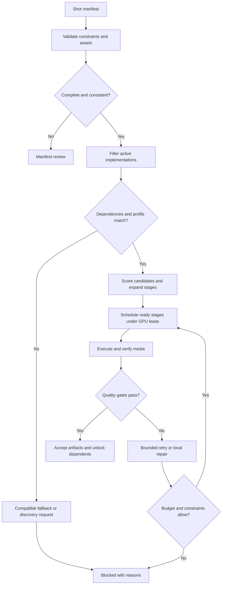

# GVD Tool Router and Workflow Discovery Specification

Version: 1.0 · Research date: 2026-09-21 · Project: Local AI / Generalized Video Director

Target: Windows workstation, NVIDIA RTX 5080 with 16GB VRAM, ComfyUI 0.36.0, Ollama. Treat the installed ComfyUI version as user-reported until local inventory confirms its backend commit. Desktop, frontend, and backend versions are distinct.

Status: Architectural specification with Python reference contracts and discovery orchestration. No workflows, checkpoints, or custom nodes were installed on the workstation in preparing this document. Hardware compatibility and performance remain unmeasured locally. The names below are GVD interfaces, not claims that those exact nodes already exist in ComfyUI.

## 1. Architectural decision

GVD selects a **capability**, resolves it to an immutable, validated **workflow implementation**, and schedules its stages through a single GPU owner. A narrative scene can be a composition of still generation, image-to-video, lip-sync, repair, and assembly. Each GPU stage is a discrete ComfyUI API workflow; the scene-level tool orchestrates their dependency graph.

Separate four concerns:

1. **Planner:** Ollama converts narrative intent into a typed shot manifest and explicit constraints. It cannot invent installed node types, change security policy, or activate downloads.
2. **Registry and router:** Deterministic code filters implementations by capability, compatibility, resource measurements, and quality requirements before scoring candidates.
3. **Scheduler and executor:** A persistent dependency graph, GPU lease, ComfyUI API adapter, artifact store, and quality gates manage execution and recovery.
4. **Discovery and validation:** Web search proposes candidates. Quarantine, isolated validation, and a promotion controller determine whether candidates enter the executable registry.

Generation remains local. Search sends generic capability and hardware queries, never private scripts, reference faces, or media. Hosted-model workflows are ineligible under the default `local_only` policy.

### 1.1 Required tool interfaces

| Public GVD tool | Intended behavior | Initial implementation candidates | Restrictions |
| --- | --- | --- | --- |
| `execute_narrative_scene` | Multi-shot scene with tracked face, clothing, props, and screen direction | StoryDiffusion stills; compatible IPAdapter conditioning; validated I2V child workflow; optional lip-sync | Identity and wardrobe are acceptance criteria, not model guarantees. The combined attention stack needs its own compatibility test. |
| `execute_continuous_take` | Extend an unbroken take from accepted temporal context | LongCat-Video continuation; MiniMax H3 FL2VA; Ref2VA only where its exact graph supplies required continuation controls | Reference conditioning alone does not guarantee exact first/last frames or motion continuation. |
| `execute_montage_morph` | Deliberate visual transformations across a prompt schedule | AnimateDiff-Evolved plus FizzNodes prompt scheduling | Prompt embedding interpolation is not a guarantee of geometry-preserving latent morphing. |
| `execute_fast_action` | Drafts, B-roll, establishing shots, action candidates | LTX-2.3; FastH3 with exact version and supported input mode | Short inference time does not establish superior physical accuracy. Test action fidelity separately. |

All four interfaces exist in the initial catalog even when no implementation is active. If every implementation is disabled, return `UNAVAILABLE_CAPABILITY` with reasons rather than pretending a workflow exists.

### 1.2 Research corrections that affect routing

**StoryDiffusion:** The upstream repository separates consistent image generation from its video motion predictor; its published low-memory demo describes testing on 24GB and expectations above 20GB. That does not prove the proposed compound workflow fits 16GB. Start with a candidate still-generation stage and measure it. [StoryDiffusion upstream](https://github.com/HVision-NKU/StoryDiffusion)

The ComfyUI wrapper combines several distinct identity methods. Its availability does not establish that arbitrary StoryDiffusion and IPAdapter attention patches compose correctly. Preserve separate implementation IDs for each tested combination. [ComfyUI StoryDiffusion](https://github.com/smthemex/ComfyUI_StoryDiffusion), [IPAdapter Plus](https://github.com/cubiq/ComfyUI_IPAdapter_plus)

**H3:** FL2VA and Ref2VA are separate model variants. The official integration catalog lists a 12–16GB quantized/offloaded path, but lists component sizes rather than an end-to-end RTX 5080 peak-memory measurement. Treat this as a promising candidate, not a validated profile. [MiniMax integration catalog](https://github.com/MiniMax-AI/awesome-minimax-h3-integration), [MiniMax H3 upstream](https://github.com/MiniMax-AI/MiniMax-H3)

**FastH3:** The Preview V1 announcement describes four-step, T2VA-only checkpoints. Current ComfyUI documentation instead describes an eight-step V2 checkpoint, T2V and first/last-frame I2V, no distilled Ref2VA, and ComfyUI 0.36.0 or later. These are different releases, not interchangeable settings. Pin the checkpoint, workflow, attention implementation, and step schedule together. The ComfyUI documentation also describes motion/audio quality tradeoffs, so speed cannot be used as a physics score. [FastH3 V1 announcement](https://haoailab.com/blogs/fasth3-preview/), [ComfyUI FastH3 guide](https://docs.comfy.org/tutorials/video/minimax/minimax-h3-fastvideo)

**LongCat and LTX:** Both are valid research targets. LTX-2.3 has official ComfyUI workflows; LongCat has upstream continuation support. Neither fact certifies a particular graph on this Windows installation. [LTX-2.3 guide](https://docs.comfy.org/tutorials/video/ltx/ltx-2-3), [LongCat-Video](https://github.com/meituan-longcat/LongCat-Video)

## 2. Files and runtime boundaries

Use configurable `GVD_ROOT`; do not assume the existing ComfyUI installation lives inside it.

| Relative path | Purpose |
| --- | --- |
| `config/runtime.json` | Explicit ComfyUI/Ollama endpoints, GPU identity, approved environment paths |
| `registry/catalog.json` | Public tool names and all candidate implementation versions |
| `registry/active.json` | Atomic snapshot of executable implementations only |
| `registry/releases/<digest>/` | Immutable registry snapshots and rollback metadata |
| `workflows/approved/<digest>/` | API JSON, bindings, dependency lock, provenance |
| `quarantine/<sha256>/` | Downloaded bytes and discovery metadata; never a `custom_nodes` directory |
| `validation/<candidate>/<run>/` | Isolated-validation logs, measurements, outputs, verdicts |
| `assets/characters/<id>/<revision>/` | Reference images, wardrobe references, prop and appearance descriptions |
| `jobs/<project>/<shot>/<attempt>/` | Rendered API request, result manifest, media, quality report |
| `state/gvd.sqlite` | Job DAG, attempts, artifact hashes, leases, prompt IDs, discovery state |

Only the promotion service writes `active.json`. Only the GPU scheduler submits production jobs. Discovery has no production credentials or permission to install Python packages. Use a dedicated ComfyUI worker where practical; a shared GUI queue cannot provide an exclusive GPU guarantee unless its writers cooperate.

## 3. Registry schema: Python data classes

Python 3.11+ reference contracts follow. Persist as JSON with schema versioning; validate at load time with an explicit JSON Schema or Pydantic adapter. Type annotations alone do not enforce runtime safety. SHA-256 fields must be 64 hexadecimal characters; revisions must be immutable commit/model revisions, never mutable branch labels.

```python
from dataclasses import dataclass, field
from typing import Any, Literal

ToolName = Literal[
    "execute_narrative_scene", "execute_continuous_take",
    "execute_montage_morph", "execute_fast_action",
    "generate_still", "upscale_still", "synthesize_dialogue",
    "apply_lipsync", "repair_video",
]
Status = Literal[
    "discovered", "quarantined", "static_pass", "validation_pending",
    "validated", "active", "disabled", "rejected", "retired",
]

@dataclass(frozen=True)
class ArtifactRef:
    asset_id: str
    sha256: str
    media_type: str
    # Resolved by GVD into its asset store, never treated as a shell path.

@dataclass(frozen=True)
class CharacterState:
    character_id: str
    revision: str
    face_refs: tuple[ArtifactRef, ...]
    wardrobe_refs: tuple[ArtifactRef, ...]
    wardrobe_description: str
    props: tuple[str, ...]
    screen_position: str
    pose: str
    expression: str

@dataclass(frozen=True)
class ShotManifest:
    shot_id: str
    script_intent: str
    camera_motion: str
    character_state: tuple[CharacterState, ...]
    continuity_mode: Literal["independent", "identity", "continuous", "morph"]
    duration_s: float
    width: int
    height: int
    fps_num: int
    fps_den: int
    hard_requirements: frozenset[str]
    priorities: dict[str, float]  # identity, motion, style, audio, latency
    dependencies: tuple[str, ...] = ()
    start_frame: ArtifactRef | None = None
    end_frame: ArtifactRef | None = None
    context_video: ArtifactRef | None = None
    audio: ArtifactRef | None = None
    prompt_keyframes: tuple[tuple[int, str], ...] = ()
    allowed_degradations: frozenset[str] = frozenset()
    seed: int = 0

@dataclass(frozen=True)
class InputParameter:
    name: str
    json_schema: dict[str, Any]  # bounds, enums, asset kind, max length
    required: bool
    default: Any = None

@dataclass(frozen=True)
class InputBinding:
    parameter: str
    node_id: str
    node_input: str
    transform: str = "identity"  # approved built-in transform ID, never code

@dataclass(frozen=True)
class OutputBinding:
    name: str
    node_id: str
    history_key: str
    media_type: str

@dataclass(frozen=True)
class Dependency:
    kind: Literal["comfy_core", "custom_node", "model", "python", "binary"]
    name: str
    source_url: str
    revision: str
    sha256: str | None
    license_id: str | None
    license_evidence_url: str | None

@dataclass(frozen=True)
class RuntimeLock:
    os: str
    python_version: str
    comfy_commit: str
    node_schema_sha256: str
    torch_version: str
    cuda_runtime: str
    driver_version: str
    gpu_name: str
    compute_capability: str
    attention_backend: str
    environment_sha256: str

@dataclass(frozen=True)
class ResourceProfile:
    profile_id: str
    runtime_lock_sha256: str
    workload_sha256: str  # exact shapes, frames, refs, steps, tiling, batch
    precision: str
    offload_mode: str
    peak_gpu_mib: int | None
    peak_host_ram_mib: int | None
    model_disk_mib: int | None
    cold_seconds: float | None
    warm_seconds: float | None
    evidence: Literal["unknown", "upstream_claim", "community_report", "local"]
    samples: int = 0
    report_uri: str | None = None

@dataclass(frozen=True)
class WorkflowTemplate:
    relative_path: str
    sha256: str
    format: Literal["comfy_api"]
    node_types: tuple[str, ...]
    inputs: tuple[InputParameter, ...]
    bindings: tuple[InputBinding, ...]
    outputs: tuple[OutputBinding, ...]
    model_family_key: str  # hash of actual loaded components and patches

@dataclass(frozen=True)
class WorkflowStage:
    stage_id: str
    template: WorkflowTemplate
    depends_on: tuple[str, ...]
    # Mapping: parameter -> "manifest.field" or "stage_id.output_name".
    input_sources: dict[str, str]

@dataclass(frozen=True)
class ToolImplementation:
    schema_version: int
    tool_name: ToolName
    implementation_id: str
    version: str
    status: Status
    capabilities: frozenset[str]
    limits: dict[str, Any]  # frame/size grids, max refs, modes, duration
    dependencies: tuple[Dependency, ...]
    runtime: RuntimeLock
    stages: tuple[WorkflowStage, ...]
    profiles: tuple[ResourceProfile, ...]
    quality_scores: dict[str, float]  # measured locally, normalized 0..1
    fallback_ids: tuple[str, ...]
    provenance_urls: tuple[str, ...]
    policy_receipt: str | None
    validation_report_sha256: str | None
    local_only: bool = True
    disabled_reason: str | None = None

@dataclass(frozen=True)
class ExecutionResult:
    shot_id: str
    attempt_id: str
    registry_digest: str
    implementation_id: str
    profile_id: str
    prompt_ids: tuple[str, ...]
    status: Literal["accepted", "retryable", "blocked", "failed"]
    artifacts: tuple[ArtifactRef, ...]
    actual_frames: int
    actual_fps_num: int
    actual_fps_den: int
    quality_report: str
    reason_codes: tuple[str, ...]
```

### 3.1 Load-time invariants

- The stage graph must be acyclic. Every input source, output binding, fallback ID, and asset reference must resolve. Detect fallback cycles separately.
- `active` requires policy and validation receipts, exact dependency hashes, a compatible runtime, and at least one local resource profile. Unknown memory is never interpreted as zero.
- Frame-count and dimension constraints belong to each workflow version. Do not apply one model's frame grid to another. Record requested and actual duration; reject rounding outside the manifest's tolerance.
- Model disk size, peak GPU allocation, and peak host RAM are separate measurements. Each model and custom node carries its own license record; open code does not imply unrestricted weights.
- Freeze each job to its registry digest. Promotion cannot change implementations underneath queued or running jobs.
- Separate identity reference support, first-frame support, last-frame support, video-context support, audio conditioning, and native audio output into individual capabilities.
- Use exact parameter binding into parsed JSON. Never interpolate a whole JSON file with string substitution, evaluate downloaded expressions, or let an LLM supply arbitrary node classes.

### 3.2 API JSON and template binding

A runnable API graph maps node IDs to objects containing `class_type` and `inputs`; visual-editor JSON commonly contains a node list and link/widget metadata. They are not interchangeable. UI-only candidates remain quarantined until exported through a compatible frontend or an explicitly tested converter. Do not guess widget positions.

The binder deep-copies an approved graph, checks its SHA-256, verifies each declared binding against `/object_info`, applies typed values, and validates the resulting graph. For an image parameter, resolve the approved asset, upload it if required, and bind the returned ComfyUI filename; do not pass an arbitrary Windows filesystem path supplied in a prompt.

The executor submits `{"prompt": graph, "client_id": client_id, "extra_data": {"gvd_attempt_id": attempt_id}}` to `/prompt`. Persist its `prompt_id`; use `/ws` for progress and `/history/{prompt_id}` for reconciliation and outputs. A successful queue response is not a successful render. Use only capabilities available in the installed backend. [ComfyUI server routes](https://docs.comfy.org/development/comfyui-server/comms_routes)

## 4. Scene-to-tool decision logic

### 4.1 Constraint precedence

Interpret the script once, then freeze its typed requirements. The classifier emits a confidence and evidence span for each inferred feature. User-specified manifest fields always outrank inferred ones. Unknown interpretation returns `NEEDS_MANIFEST_REVIEW`; it does not silently choose the fastest tool.

| Manifest signals | Route preference | Hard checks |
| --- | --- | --- |
| Continuous camera movement, no cuts, accepted preceding clip | `execute_continuous_take` | Required start/context inputs, compatible duration, boundary-quality policy |
| Recurring cast across edits, fixed wardrobe/props | `execute_narrative_scene` | Character references and revision, composition, downstream I2V identity tests |
| Explicit dream/morph intent with keyframes | `execute_montage_morph` | Valid prompt schedule, matching timebase, constraints on intentional identity changes |
| Independent establishing/action/B-roll shot | `execute_fast_action` | Supported input mode and measured motion quality |
| Dialogue with visible mouth | Add `synthesize_dialogue` and `apply_lipsync`, or an audio-conditioned renderer | Audio precedes lip-sync; face track remains available and synchronized |
| Local artifact in an otherwise accepted clip | `repair_video` | Source clip, tracked mask, affected time interval, preservation requirements |

A continuous take featuring a named character must satisfy both constraints. Do not let a high motion score compensate for missing identity conditioning. If no implementation can satisfy the conjunction, return `NO_COMPATIBLE_TOOL` with the missing capabilities. Splitting a no-cut shot or turning a named character into anonymous B-roll requires an explicit manifest revision.

### 4.2 Routing flowchart



### 4.3 Router pseudocode

```text
route(manifest, registry_snapshot, inventory):
    validate manifest, references, timeline, and dependency graph
    required = explicit hard constraints + validated mode requirements
    candidates = active implementations compatible with preferred tool family
    for implementation in candidates:
        reject unless required is a subset of capabilities
        reject unless all stage inputs and dependencies resolve
        reject unless exact environment/model/node hashes match inventory
        reject unless local-only policy is satisfied
        select a locally measured profile covering this exact workload
        if none exists: emit PROFILE_REQUIRED; do not production-render
        reject unless every stage fits GPU, host RAM, and disk budgets
        reject unless profile meets manifest quality floors
    if candidates empty:
        evaluate declared fallback IDs with the SAME checks and a visited set
        enqueue generic discovery request if still empty
        return blocked decision with per-candidate rejection reasons
    rank by measured quality, latency, failure rate, and switching cost
    choose deterministic winner, breaking ties by implementation_id
    persist decision, registry digest, profile, and expanded stage DAG
```

Suggested initial scoring policy, applied only after hard filtering:

`score = 0.35*identity_fit + 0.30*motion_fit + 0.15*style_fit + 0.10*audio_fit + 0.10*reliability - 0.10*normalized_latency - 0.08*normalized_switch_cost`

These coefficients are design defaults, not research findings. Renormalize relevant quality weights from manifest priorities. A required dimension needs a measured minimum; missing measurements cannot receive an optimistic score. Calibrate on a small GVD evaluation set and retain the policy version with every decision.

### 4.4 Boundary verification and character continuity

For continuous extensions, store the accepted predecessor's final frame, a short tail window, audio tail, frame rate, color space, camera direction, and artifact hashes. Extract from the accepted intermediate, not a screenshot or preview. The next segment waits for predecessor acceptance.

Compare generated head/tail windows for cuts, flicker, color shift, motion direction and velocity, identity, wardrobe, and prop continuity. Use optical flow and image/identity metrics as signals; calibrated visual review remains necessary for ambiguous seams. No universal cosine or pixel threshold establishes continuity.

Deduplicate shared boundary frames only where the workflow contract says they overlap. Matching one endpoint does not establish matching velocity. A failed seam gets a bounded re-render with more context or a compatible model; a dissolve is allowed only if the manifest permits one.

For narrative scenes, maintain a character bible including full-body and clothing references. Face embeddings alone cannot verify clothing or objects. Generate and accept anchor stills before animation; then inspect first/middle/last frames and flagged intervals of each clip. Persist approved scene state at every cut so later shots cannot silently revert props or wardrobe.

## 5. Expanded workflow catalog

The following is a source-grounded shortlist, not a claim that every candidate is an industry standard or already production-ready. Every row begins disabled pending local validation. “Priority” is the proposed validation order.

| Area / priority | Source and integration | GVD role | Validation focus |
| --- | --- | --- | --- |
| Narrative / P1 | [StoryDiffusion ComfyUI wrapper](https://github.com/smthemex/ComfyUI_StoryDiffusion) and [IPAdapter Plus](https://github.com/cubiq/ComfyUI_IPAdapter_plus) | Anchor stills, identity conditioning | Attention-patch compatibility; per-character masks; drift; 16GB feasibility |
| Stills / P1 | [FLUX upstream](https://github.com/black-forest-labs/flux) | Composition, image editing, Fill, depth/edge-guided stills | Match controls to exact model; measure quantized/offloaded configuration |
| Multi-character / P2 | [StoryDiffusion wrapper's MS-Diffusion and related identity modes](https://github.com/smthemex/ComfyUI_StoryDiffusion) | Multiple subjects with separate references | Identity swapping, clothing leakage, spatial placement; do not assume a single FLUX prompt solves identity |
| Framing / P1 | [ControlNet auxiliary preprocessors](https://github.com/Fannovel16/comfyui_controlnet_aux) | Pose, depth, and edge preparation | Preprocessor output alone is not conditioning; require matching control model |
| Upscale / P1 | [ComfyUI TiledDiffusion](https://github.com/shiimizu/ComfyUI-TiledDiffusion) | Tile-based still refinement and VAE memory reduction | Tile seams and changed faces/text; still upscaling can flicker when applied independently to video |
| Montage / P1 | [AnimateDiff-Evolved](https://github.com/Kosinkadink/ComfyUI-AnimateDiff-Evolved) plus [FizzNodes](https://github.com/FizzleDorf/ComfyUI_FizzNodes) | Motion modules, prompt travel | Model/motion-module compatibility, context windows, schedule interpolation |
| Video utility / P1 | [VideoHelperSuite](https://github.com/Kosinkadink/ComfyUI-VideoHelperSuite) | Decode, frame batching, output assembly | FPS, frame count, audio duration, codec behavior |
| Audio / P2 | [F5-TTS upstream](https://github.com/SWivid/F5-TTS) | Local dialogue from text and authorized voice reference | Voice consistency, pronunciation, time alignment; select a reviewed Comfy wrapper or build a narrow local adapter |
| Lip-sync / P2 | [MuseTalk upstream](https://github.com/TMElyralab/MuseTalk), [MuseTalk-KJ nodes](https://github.com/kijai/ComfyUI-MuseTalk-KJ) | Audio-driven face-region synthesis | Side profiles, occlusions, mouth artifacts, sync error; real-time upstream claims are not 5080 measurements |
| Mask tracking / P2 | [SAM 2](https://github.com/facebookresearch/sam2) | Video mask propagation for repair | Mask drift, occlusion handling, Windows/node integration; not itself an inpainting model |
| Repair / P2 | [ProPainter](https://github.com/sczhou/ProPainter) | Temporal video inpainting and object removal | Temporal windows, flow consistency, RAM usage; Comfy adapter remains an integration task |
| Video alternatives / P2 | [WanVideoWrapper](https://github.com/kijai/ComfyUI-WanVideoWrapper) | Additional video/control pipelines where supported by the pinned graph | Exact Wan variant and node requirements; qualifying profile required |
| Continuous / P2 | [LongCat-Video](https://github.com/meituan-longcat/LongCat-Video) | Video continuation candidate | Windows/Comfy adapter, offload requirements, drift and repeated actions |
| Fast / P1 | [LTX-2.3 official workflows](https://docs.comfy.org/tutorials/video/ltx/ltx-2-3) | Drafts and motion-oriented video candidates | Quantization, offload, reference limits, native audio, physics evaluation |
| Fast / P2 | [FastH3 official workflows](https://docs.comfy.org/tutorials/video/minimax/minimax-h3-fastvideo) | Eight-step V2 draft candidate | Distinguish from four-step V1; no automatic Ref2VA fallback |

For F5-TTS and ProPainter, upstream capability was verified but a deployable ComfyUI wrapper was not established by this research. Register them as `adapter_required`, not as existing executable API templates. If wrapped, the custom node calls an approved local service with typed inputs and a fixed endpoint, never a generic shell command. The service must participate in the same GPU lease.

### 5.1 Dialogue composition

Render dialogue first when the shot timing depends on speech. Store the original waveform, transcript, speaker ID, sample rate, and timing. Generate the shot from its audio where supported, or apply a dedicated lip-sync pass after video generation. Resample audio explicitly and preserve exact video timebase. Do not let both a native-audio model and a mux step produce competing dialogue tracks.

Benchmark lip-sync offline first. Live inference is a separate profile including preprocessing and output latency. A model capable of audio-driven mouth motion is not necessarily a complete real-time facial animation system.

### 5.2 Repair without full re-generation

The repair request identifies a source artifact, frame interval, mask track, desired change, and protected regions. Decode only the affected interval plus temporal handles. Track and refine masks, crop with spatial context where supported, inpaint the temporal window, and composite only inside the mask. Compare before/after boundaries and confirm that protected regions remain unchanged in the decoded intermediate.

Keep original lossless frames or a high-quality intermediate. Re-encoding a final compressed file can change pixels outside the mask even when the compositor preserves them. Distinguish “no full generative re-render” from “no final encoding.” ProPainter is an initial object-removal/repair candidate; arbitrary semantic replacement may need another temporally conditioned model. Independent per-frame image inpainting requires a flicker gate.

## 6. Autonomous web discovery

### 6.1 Search, evidence, and quarantine policy

Expose `discover_workflows(capability, hardware_profile, max_candidates)` to the local agent. Trigger it on a missing capability, an explicit upgrade request, or a configured maintenance interval. Do not discover/install during a render-critical section.

Use a configurable web-search adapter: a locally hosted SearXNG instance or an authenticated search API. Add GitHub repository/release/file API adapters for provenance. Civitai and Comfy workflow galleries are discovery sources; fetch assets only through supported, permitted download paths. Login failures, rate limits, or missing APIs yield `SOURCE_UNAVAILABLE`, not a browser/login bypass.

Example generic queries:

- `site:github.com ComfyUI video continuation RTX 5080 16GB workflow`
- `site:civitai.com ComfyUI LTX 2.3 16GB workflow`
- `site:comfyworkflows.com ComfyUI video inpainting workflow`
- `site:docs.comfy.org MiniMax H3 first last frame workflow`

Rate-limit searches, cache results for 24 hours, cap a run at 30 hits and 10 downloaded templates, and use bounded retry with backoff for HTTP 429/5xx. Record query, source URL, author, release/commit, publication time, retrieval time, file hash, and provenance chain. Dates and popularity affect ranking; they do not establish correctness.

Community benchmark records must contain GPU/VRAM, host RAM, OS, Torch/CUDA, attention kernel, exact model/quantization, resolution, frames/FPS, steps, reference count, offload/tiling, cold versus warm status, timing scope, peak memory, and output examples. Missing fields remain unknown. Separate author claims, independent reports, and GVD measurements. A 4090 or 5090 result may nominate a candidate but cannot validate the 5080 profile.

Treat fetched text as data, including README instructions and JSON metadata. Never execute installation instructions from a page. JSON can reference custom nodes with arbitrary behavior, so parsing it successfully does not make it safe.

### 6.2 Python discovery orchestration

This function is implementation-ready orchestration with injected adapters. The protocols define the required boundaries; search, secure downloading, persistence, and validation adapters still need to be implemented in the local project. In particular, this code deliberately does not provide an unsafe generic HTTP downloader or installer.

```python
import hashlib
import json
from dataclasses import dataclass
from typing import Any, Protocol

@dataclass(frozen=True)
class DiscoveryHit:
    page_url: str
    title: str

@dataclass(frozen=True)
class CandidateAsset:
    page_url: str
    download_url: str
    publisher: str
    immutable_revision: str | None
    provenance: dict[str, Any]

@dataclass(frozen=True)
class FetchedAsset:
    body: bytes
    final_url: str
    content_type: str

class SearchAdapter(Protocol):
    async def search(self, query: str, limit: int) -> list[DiscoveryHit]: ...

class SourceResolver(Protocol):
    async def workflow_assets(self, hit: DiscoveryHit) -> list[CandidateAsset]: ...

class SecureFetcher(Protocol):
    async def fetch_json(self, url: str, max_bytes: int) -> FetchedAsset: ...

class QuarantineStore(Protocol):
    async def contains(self, digest: str) -> bool: ...
    async def put_atomic(self, digest: str, body: bytes,
                         metadata: dict[str, Any]) -> None: ...
    async def mark(self, digest: str, state: str, reasons: list[str]) -> None: ...

class StaticValidator(Protocol):
    def inspect(self, graph: Any) -> tuple[str, list[str]]: ...
    # Verdict: reject, ui_export_required, or api_candidate.

class ValidationQueue(Protocol):
    async def enqueue(self, digest: str, capability: str) -> None: ...

def reject_duplicate_keys(pairs):
    result = {}
    for key, value in pairs:
        if key in result:
            raise ValueError("duplicate JSON key")
        result[key] = value
    return result

def reject_nonfinite(value):
    raise ValueError("non-finite JSON number")

ALLOWED_CAPABILITIES = {
    "narrative_identity", "video_continuation", "montage_morph",
    "fast_action", "still_generation", "tts", "lipsync", "video_inpainting",
}

async def discover_workflows(
    capability: str, search: SearchAdapter, resolver: SourceResolver,
    fetcher: SecureFetcher, store: QuarantineStore,
    validator: StaticValidator, queue: ValidationQueue,
    max_candidates: int = 10,
) -> list[dict[str, Any]]:
    if capability not in ALLOWED_CAPABILITIES:
        raise ValueError("unsupported discovery capability")
    if not 1 <= max_candidates <= 10:
        raise ValueError("candidate budget must be 1..10")
    phrase = capability.replace("_", " ")
    domains = ("github.com", "civitai.com", "comfyworkflows.com")
    results: list[dict[str, Any]] = []
    seen_pages: set[str] = set()
    attempted = 0
    for domain in domains:
        query = f"site:{domain} ComfyUI {phrase} RTX 5080 16GB workflow"
        try:
            hits = await search.search(query, limit=10)
        except Exception as exc:
            results.append({"state": "source_unavailable",
                            "source": domain, "error_type": type(exc).__name__})
            continue
        for hit in hits[:10]:
            if hit.page_url in seen_pages:
                continue
            seen_pages.add(hit.page_url)
            try:
                assets = await resolver.workflow_assets(hit)
            except Exception as exc:
                results.append({"state": "resolution_failed",
                                "page": hit.page_url,
                                "error_type": type(exc).__name__})
                continue
            for asset in assets[:3]:
                if attempted >= max_candidates:
                    return results
                attempted += 1
                digest = None
                try:
                    fetched = await fetcher.fetch_json(
                        asset.download_url, max_bytes=2_000_000)
                    if len(fetched.body) > 2_000_000:
                        raise ValueError("oversized workflow")
                    digest = hashlib.sha256(fetched.body).hexdigest()
                    if await store.contains(digest):
                        results.append({"digest": digest, "state": "duplicate"})
                        continue
                    await store.put_atomic(digest, fetched.body, {
                        "query": query, "page_url": asset.page_url,
                        "final_url": fetched.final_url,
                        "publisher": asset.publisher,
                        "revision": asset.immutable_revision,
                        "provenance": asset.provenance,
                    })
                    graph = json.loads(
                        fetched.body.decode("utf-8"),
                        object_pairs_hook=reject_duplicate_keys,
                        parse_constant=reject_nonfinite,
                    )
                    verdict, reasons = validator.inspect(graph)
                    if verdict not in {"reject", "ui_export_required", "api_candidate"}:
                        raise ValueError("invalid static verdict")
                    state = {
                        "reject": "rejected",
                        "ui_export_required": "quarantined",
                        "api_candidate": "validation_pending",
                    }[verdict]
                    await store.mark(digest, state, reasons)
                    if state == "validation_pending":
                        await queue.enqueue(digest, capability)
                    results.append({"digest": digest, "state": state,
                                    "reasons": reasons})
                except Exception as exc:
                    # Log sanitized error details; never expose tokens/headers.
                    if digest is not None:
                        await store.mark(digest, "quarantined",
                                         [type(exc).__name__])
                    results.append({"digest": digest, "state": "quarantined",
                                    "error_type": type(exc).__name__})
    return results
```

Required adapter behavior:

- **SecureFetcher and SourceResolver:** HTTPS only; approved exact hosts/download CDNs; reject credentials in URLs; verify DNS results and the connected peer are public addresses; block private/link-local/loopback destinations and metadata services; recheck redirects and prevent DNS rebinding. Enforce connection/read/total timeouts, decompressed-byte limits, and JSON content expectations. No archives, executable downloads, or model downloads in discovery.
- **StaticValidator:** Bounded JSON depth/node count; distinguish UI/API format; check node structures, typed links, outputs, graph cycles, model references, and declared bindings. Unknown classes go to dependency review. Reject dynamic code/eval/shell nodes, unapproved network nodes, remote loaders, and arbitrary filesystem destinations. An approved node class must also resolve to a pinned, reviewed implementation.
- **QuarantineStore:** Hash-derived directory names only; no source-supplied paths. Atomic creation, unique digest constraint, immutable downloaded bytes, separate append-only metadata. A duplicate download may add provenance without replacing bytes. The store adds UTC timestamps itself.
- **ValidationQueue:** Durable jobs with unique candidate/profile keys. Reconcile `validation_pending` records periodically so a crash between marking and enqueueing does not lose work. Quarantine errors are not activation grants.

### 6.3 Local validation and automatic promotion

Candidate lifecycle: `discovered → quarantined → static_pass → validation_pending → validated → active`. Failures go to `rejected` or `disabled` with a reason; never directly to active.

1. Resolve node source and model provenance; pin commits and hashes. Inspect package changes, entry points, dependency constraints, and license records. No model loader may enable remote code implicitly.
2. Run dependency installation/import tests in a disposable environment with no production secrets or personal folders. A virtual environment alone is not a security sandbox. On Windows, use an appropriately isolated worker/VM with restricted filesystem and network access; if safe GPU isolation is unavailable, hold novel executable code for review. Do not auto-test it inside production ComfyUI.
3. Validate API graph and node schemas against an isolated backend. Smoke-test the smallest supported workload, then benchmark actual target profiles under the GPU lease.
4. Capture cold/warm latency, GPU/host memory peaks, failures, artifacts, and quality reports. Run at least three representative samples including difficult identity/motion/audio cases relevant to the capability.
5. Promotion requires matching dependencies, local resource fit, minimum quality, and no disallowed regression on the GVD evaluation set. Templates using already approved nodes/models can promote automatically after these gates. New executable packages require a code-trust receipt from the configured review process before automatic integration.
6. Build a new immutable registry snapshot and activate it atomically between jobs. Retain the previous snapshot. Roll back on regression; jobs already started keep their original snapshot and assets.

Community scores only prioritize validation. New workflow text cannot alter promotion thresholds, allowlists, or permitted hosts. Discovery records an upgrade proposal even when promotion is blocked.

## 7. Memory and VRAM flip-flop controller

### 7.1 Resource policy for 16GB

Use MiB from actual device telemetry rather than assuming all advertised VRAM is available. Proposed starting headroom: **2,048 MiB** for display/driver activity and transient allocations, increased if measured peaks fluctuate. This is a design margin, not a benchmark result.

Cold admission after releasing prior models requires:

`profile.peak_gpu_mib + headroom_mib <= observed_free_gpu_mib`

Define `peak_gpu_mib` as the additional worker footprint above its idle baseline during a cold target-profile run, including the workflow's models, activations, and decode. Capture whole-device peak usage as a cross-check. Warm admission needs a separately measured incremental profile or a conservative total-budget test; do not double-count already resident model memory against free VRAM.

Host-RAM admission likewise uses observed available RAM minus an OS reserve and includes checkpoint loading, offloaded tensors, decoded frames, and audio buffers. Detect installed RAM during inventory. Disk space checks cover checkpoints, temporary frames, and output attempts. Swapping into the Windows pagefile is not an accepted normal execution strategy.

Never reserve all 16GB for diffusion while Ollama remains resident. Plan a batch, unload the planner model, run GPU stages, then reload Ollama if needed. A small CPU planner is an optional alternative if latency permits. Ollama's generate API supports `keep_alive: 0` for immediate unloading. [Ollama generate API](https://docs.ollama.com/api/generate)

### 7.2 Scheduling without breaking continuity

Batch means **sequential jobs sharing model residency**, not multiple videos in a tensor batch. Start with GPU batch size one.

Only stages whose dependencies and input artifacts are accepted enter the ready set. Group that set by the hash of actual checkpoints, encoders, VAEs, LoRAs, attention patches, precision, and worker environment. A shared public tool name is insufficient: two H3 variants may need different models.

Choose the ready group with the best combination of deadline, job age, critical-path impact, and saved load time. Keep the current family for a bounded quantum, initially four shots or fifteen minutes of completed work; never interrupt an active shot just to meet the quantum. Increase age priority to prevent starvation.

Example: Generate ready LTX B-roll, unload it, generate a StoryDiffusion anchor group, accept its stills, then animate the newly ready I2V shots together. A continuation segment cannot leap ahead of its predecessor just because its checkpoint is already loaded. Preserve edit order in the output timeline independently of generation order.

### 7.3 Model switch protocol

```text
switch_to(target_family):
    acquire machine-wide cooperative GPU lease
    stop dispatching new production work
    wait for the owned worker's running and pending queue to become empty
    if foreign jobs exist: wait or report resource contention; do not clear them
    unload any GVD-managed Ollama GPU model; verify device telemetry
    POST ComfyUI /free {"unload_models": true, "free_memory": true}
    poll queue and memory until stable or timeout
    if residual allocations prevent admission:
        restart only the owned idle worker once, reconcile state, re-measure
    if target profile still fails resource admission: return RESOURCE_BLOCKED
    submit one target-family job and measure load + inference + decode peaks
    retain family only while the scheduler benefits from its residency
```

`/free` is a memory-release request, not proof that all CUDA allocations are gone or that another process released its models. Verify its exact behavior against the installed backend source and API during bootstrap; the current upstream source and route documentation are reference material, not a substitute for the 0.36.0 runtime check. [ComfyUI source](https://github.com/Comfy-Org/ComfyUI/blob/master/server.py)

Calling `torch.cuda.empty_cache()` in the router process cannot free tensors owned by the ComfyUI process. Also, ComfyUI unloading cannot release Ollama's GPU allocations. A worker restart is a recovery mechanism for retained custom-node allocations, not a per-shot routine.

### 7.4 Precision, offload, and attention policy

- Use only quantization/attention/tiling settings supported by the exact workflow and measured on this runtime. Blackwell support must include the actual kernel execution test; successful Python import is insufficient.
- Begin with the installed PyTorch attention path as the reference. Treat SageAttention, VSA, NVFP4, and other optimized kernels as separate candidate profiles. Never install a global attention override based solely on another GPU's speed claim.
- Text encoding, diffusion, and VAE decode may have different memory peaks. Prefer staged loading, CPU offload, and validated tiled decode. Test quality changes caused by quantization and tiling.
- Cache text embeddings only with a cache key covering encoder/model/tokenizer revisions, prompt, reference inputs, precision, and preprocessing. Avoid persistent GPU caches by default. Cache model-specific latents only with their full provenance.
- Stream decoded frames to disk and use bounded temporal windows for repair. Avoid keeping a full uncompressed movie in RAM.

### 7.5 OOM and failure policy

| Failure | Response |
| --- | --- |
| Missing node/model or hash mismatch | Disable the affected implementation; emit dependency report; evaluate compatible fallback |
| CUDA OOM | Release owned resources; invalidate the failed profile for that workload; retry only with a prevalidated lower-memory profile |
| No compatible kernel | Return to a previously validated attention backend; never blindly patch the production environment |
| Quality failure | Retry with bounded seed/prompt changes, or route a localized repair; retain original and failed artifacts |
| Ambiguous submission timeout | Reconcile queue/history by attempt metadata before resubmitting; otherwise hold for review to prevent duplicate renders |
| WebSocket disconnect | Reconnect and reconcile by prompt ID; do not treat disconnection as render failure |
| Worker crash | Mark attempt interrupted, restart only the owned worker, reconcile outputs, then retry within budget |
| No acceptable fallback | Return blocked shot with unmet constraints and discovery proposal |

Default attempt budget: initial render plus two retries; at most one owned-worker restart per shot. These are configurable limits. A resolution reduction, duration shortening, cut insertion, audio replacement, or loss of identity constraints is permitted only when named in `allowed_degradations`. Fewer sampling steps generally reduce time; do not assume they solve peak memory.

## 8. Verification and acceptance gates

### 8.1 Bootstrap inventory

The local implementation records: GPU name and memory; CUDA capability; driver; installed Torch/CUDA; Python; ComfyUI backend commit; custom-node commits; model hashes; disk/RAM availability; actual endpoints; and `/object_info` schema. Preserve the existing production environment and lockfile before adding anything. Do not copy historical CUDA/Torch pins from an old model README into a Blackwell installation.

### 8.2 Required tests

| Test | Passing result |
| --- | --- |
| Four-family routing | Independent B-roll, named-character cuts, an uninterrupted extension, and a keyed dream montage select appropriate eligible implementations |
| Combined constraints | A continuous take with strict identity blocks if no active workflow supports both |
| Version separation | FastH3 V1 T2VA cannot accept FL2VA/Ref2VA requests; V2 capabilities reflect its own verified graph |
| Unknown VRAM | Candidate cannot enter production without a local matching profile |
| Scheduling | Ready shots group by model family; a dependent extension never runs before its predecessor is accepted |
| GPU ownership | Ollama and ComfyUI do not simultaneously exceed budget; foreign jobs are not interrupted |
| Discovery attack fixtures | Reject malicious URLs, redirects to local addresses, duplicate keys, oversized/deep JSON, path traversal, shell/eval nodes, and instructions embedded in metadata |
| UI workflow fixture | Staged for compatible API export, never submitted as an API prompt |
| Crash recovery | An interrupted discovery enqueue is reconciled; an ambiguous prompt submission does not create duplicate work |
| Registry rollback | A failed candidate can be removed atomically while in-flight jobs retain their pinned snapshot |
| Repair preservation | Protected decoded regions, source audio, timing, and unaffected shots are preserved |
| End-to-end sample | A short mixed scene renders, passes quality gates, assembles in narrative order, and records full provenance |

For each approved resource profile, measure a cold run and at least three warm runs at its claimed workload. Save median latency, maximum observed GPU/RAM usage, and quality artifacts. Test both a within-budget and an intentionally blocked oversized request. Do not extrapolate one tiny smoke test to production resolution, long duration, or extra references.

Quality evaluation includes identity/wardrobe/prop continuity, motion plausibility, flicker, seamless continuation where requested, dialogue accuracy and lip-sync, and final media integrity. Automatic metrics nominate failures; they do not establish human-quality equivalence by themselves.

## 9. Implementation milestones and handoff

| Milestone | Concrete deliverable | Completion gate |
| --- | --- | --- |
| M0: Inventory | `runtime.json`, environment/model lock, node-schema snapshot | Existing installation reproduced and GPU budget measured |
| M1: Registry/executor | Typed loader, API binder, persistent attempts and results | One existing known-good local workflow executes and reconciles |
| M2: Router/scheduler | Four public tool interfaces, stage DAG, GPU lease, bounded fallbacks | Routing and scheduling tests pass without new models |
| M3: Initial profiles | Validated implementations covering the four families where feasible | Local quality/resource evidence; unsupported families visibly blocked |
| M4: Discovery | Search adapters, quarantine store, static validator, durable validation queue | Malicious/invalid fixtures blocked and valid JSON staged |
| M5: Promotion | Isolated validation, policy receipts, atomic activation and rollback | Approved candidate integrates automatically without production mutation during a job |
| M6: Production extensions | Dialogue, lip-sync, mask tracking and repair | Mixed scene assembles with preserved continuity and timing |

Implement M0–M2 around the workstation's existing successful workflow first. This establishes the control plane before large model downloads. Then validate LTX and the still/identity stack, followed by montage and continuation candidates; fit and quality determine activation, not the order listed in a model catalog.

The next local-agent task is to read this specification, inspect the actual GVD repository and any `AGENTS.md`, compare its existing interfaces to these contracts, and implement M0–M2 in the project's normal development workflow. It must report mismatches and verify this specification against installed code before applying changes. Do not claim M3–M6 complete merely because registry entries or documentation exist.

## 10. Deliverable boundary

This specification supplies the registry data classes, routing logic and flowchart, source-linked candidate catalog, discovery function and adapter contracts, quarantine/promotion design, and memory-switching strategy. It intentionally contains no fabricated ComfyUI workflow graphs, benchmark numbers, installed-node inventories, or model hashes. Those become concrete artifacts during local inventory and validation.
