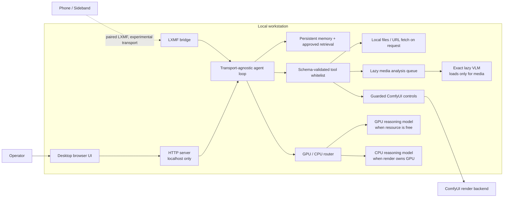
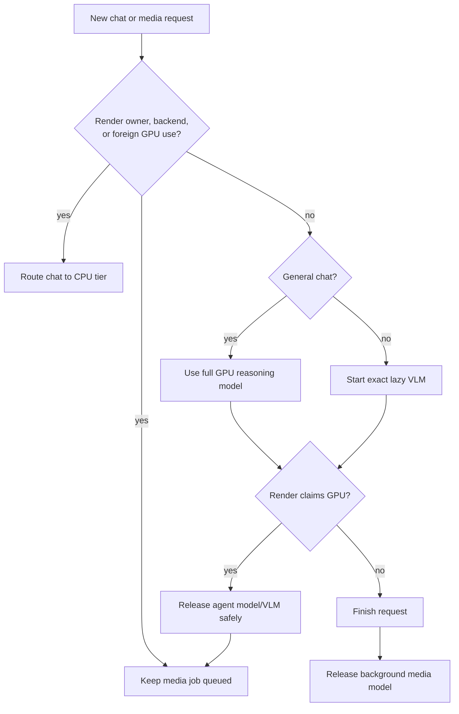
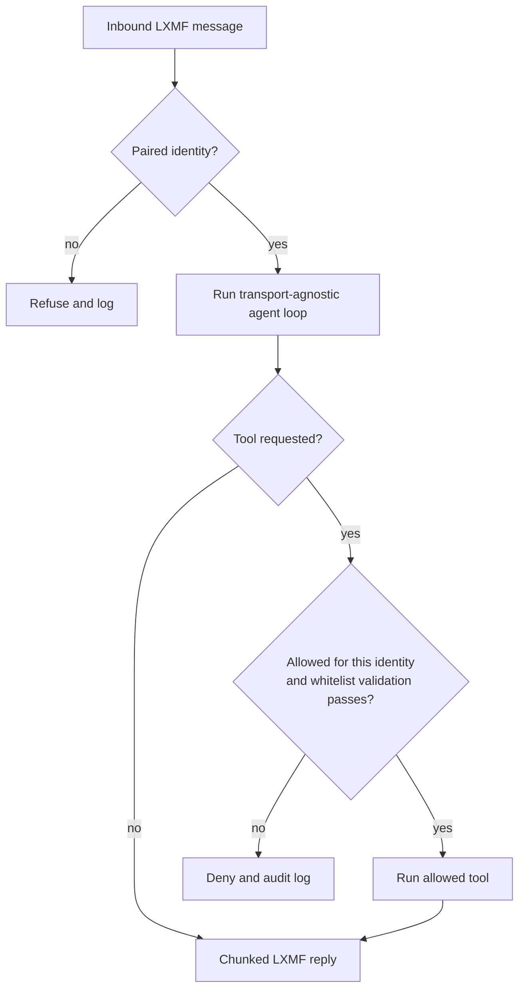

# Local Agent — sanitized architecture overview

This diagram is deliberately suitable for a portfolio draft. It omits local
paths, project media, credentials, paired identities, radio settings, and model
weight locations. It distinguishes verified interfaces from experimental work.

## System boundary

## GPU ownership and model lifecycle

## Remote permission decision

## Portfolio claim labels

- **Verified local components:** localhost GUI, structured tool calling, tool
  validation, model routing, private-safe H3 evaluation, and a paired Sideband
  Tier A round trip.
- **Experimental:** LoRa/RNode mesh delivery and its reliability/latency
  measurements.
- **In progress:** custom Sideband Android packaging and direct phone media
  integrations.
